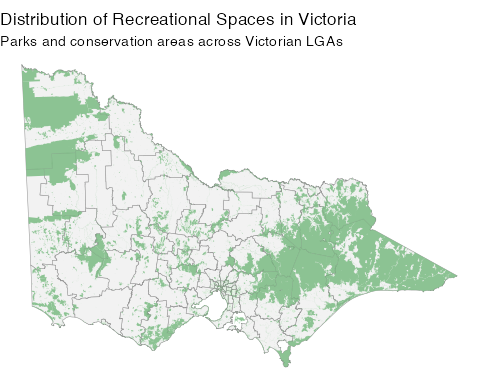
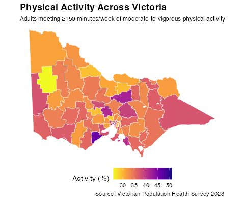
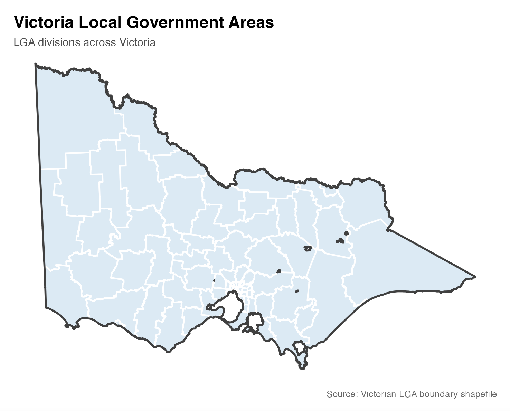
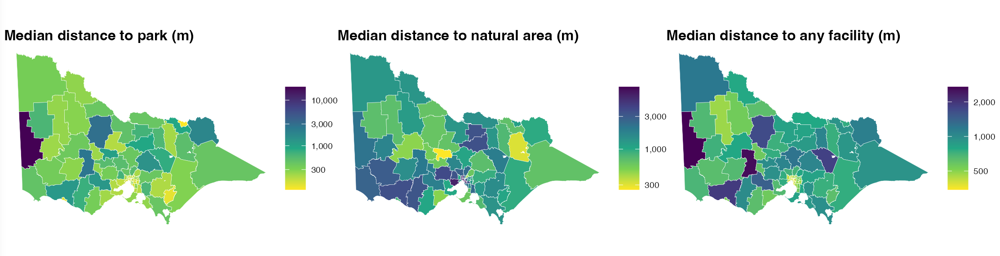
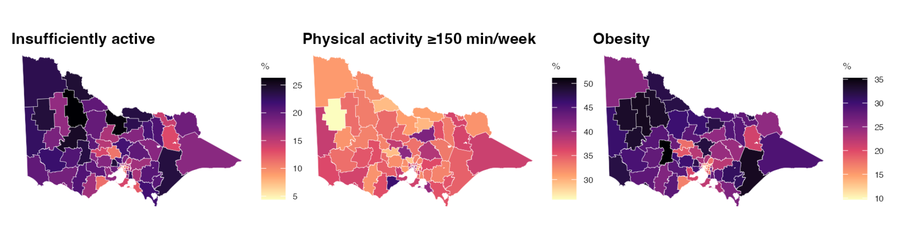
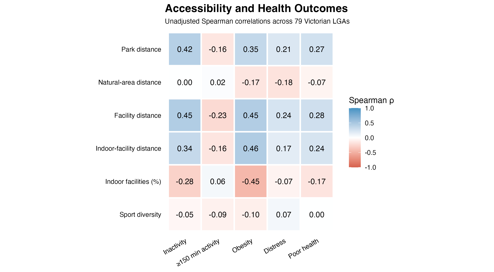

---
title: Recreational Spaces and Health Outcomes Across Victoria
author: Nana Cheng, Kaiyi Ye, Jingyi Wang
date: today
toc: false
format:
  presentation-revealjs+letterbox:
    fontsize: 26px
---


```{r}
#| label: load-packages
#| include: false
library(knitr)
library(ggplot2)
library(dplyr)
library(tidyverse)
options(width = 70)
```


## Why Does Recreational Accessibility Matter?

**Does access to recreational spaces help explain differences in health?**

- Parks, natural areas and sports facilities provide opportunities for physical activity.

- Access to these spaces varies across communities in Victoria.

- Socioeconomic conditions and population density may also help explain differences in physical activity and health outcomes.


::: {.columns}

::: {.column width="50%"}

{height="420px"}

:::

::: {.column width="50%"}

{height="420px"}

:::

:::


## Research Questions

::: {style="font-size: 0.85em;"}

### Main Research Question

Does recreational accessibility explain additional variation in physical activity and health outcomes across Victoria, beyond socioeconomic conditions and population density?

### Specific Questions

1. How much variation is explained by socioeconomic conditions and population density?

2. Does adding recreational accessibility improve model fit?

3. Which accessibility dimensions provide the greatest additional explanatory power?

:::


## Study Area & Data Sources

::: {.columns}

::: {.column width="55%"}


**79 Local Government Areas**  

{width="100%"}

:::

::: {.column width="45%"}

### Data Sources

::: {style="font-size: 0.82em;"}

**Victorian Department of Health**

Population Health Survey (2023)

**Australian Bureau of Statistics**

Socioeconomic, population and Mesh Block data

**Department of Transport and Planning**

Planning zones and local government boundaries (2026)

**Department of Jobs, Skills, Industry and Regions**

Sport and Recreational Facilities (2024)

:::

:::

:::


## Variables & Their Roles

::: {.columns}

::: {.column width="32%"}

### Baseline Predictors


**Socioeconomic Conditions**

- Socio-Economic Indexes for Areas (2021)
- Based on Census indicators of income, education, employment, occupation, housing and family structure


**Population Density**

- 2023 population / land area (km²)

:::

::: {.column width="35%"}

### Additional Predictors

**Recreational Accessibility**

Median distance (m) to:

- Parks
- Natural areas
- Any recreational facility
- Indoor facilities

Other indicators:

- Indoor facilities (%)
- Sport types available

:::

::: {.column width="33%"}

### Outcome Variables

- Inactivity: insufficient activity
- Activity: ≥150 min/week
- Obesity: BMI ≥30
- High psychological distress
- Fair/poor self-rated health

:::

:::


## How Do We Measure Recreational Accessibility?

::: {.columns}

::: {.column width="50%"}

{width="100%"}

*Example: Monash LGA contains 2,335 Mesh Blocks.*

:::

::: {.column width="50%"}

### Step 1: Locate Residents

- Use populated 2021 Census Mesh Blocks
- Represent each using a point within the Mesh Block

### Step 2: Measure Distances

- Calculate straight-line distance to the nearest:
  - Park or natural area
  - Recreational or indoor facility

### Step 3: Aggregate

- Use Mesh Block population as weights
- Calculate the population-weighted median distance for each LGA

:::

:::


## EDA: Recreational Accessibility Varies Across Victoria

{width="100%"}

Recreational accessibility varies substantially across Victorian LGAs, with different spatial patterns across recreational space types.


## EDA: Health Outcomes Also Vary Across Victoria

{width="100%"}

Health outcomes also differ across Victorian LGAs.


## EDA: Accessibility vs Health Outcomes

::: {.columns}


::: {.column width="55%"}
{width="100%"}

:::
::: {.column width="45%"}

sssp
:::

:::


## EDA: Socioeconomic Conditions vs Accessibility vs Health Outcomes


## EDA: Population Density vs Accessibility vs Health Outcomes


## EDA: Correlations among Accessibility


## From EDA to Model Design


## Motivation

### *Does living near a park make you healthier?*

- Physical activity is a key driver of health outcomes
- Access to recreational spaces varies widely across Victorian LGAs
- Evidence can inform local planning decisions


## Research questions


Is greater accessibility to recreational spaces associated with higher levels of physical activity and better health outcomes across Victorian LGAs?

### Sub-questions

- How can recreational space accessibility be measured at the LGA level?
- Is greater accessibility associated with higher levels of physical activity?
- Is greater accessibility associated with better health outcomes?
- Do these relationships remain after controlling for socioeconomic, demographic and location?

## Research design at a glance


## Data sources

- LGA
- Sport and recreational facilities dataset
- Health outcome dataset
- LGA-level physical activity and health dataset
- LGA-level SEIFA dataset
- Parks and planning zones dataset

## Define Recreational Space

- Parks and planning zones (PPRZ / PCRZ)
- Sport and recreation facilities

## Measuring Accessibility

- Median distance to park (m)
- Median distance to natural area (m)
- Median distance to any facility (m)
- Median distance to indoor facility (m)
- Indoor facilities (%)
- Sport types available

## Health outcomes & controls

**Health outcomes**
- Insufficiently active (less than moderate)
- Physical activity (≥150 min/week)
- Obesity (BMI ≥30)
- High psychological distress
- Fair/poor self-rated health

## EDA: distributions of health outcomes

```{r}
#| label: EDA-distributions-health
#| include: false

analysis_lga <- read_csv("clean_data/analysis_lga.csv")

outcomes <- c(
  "Insufficiently active (less than moderate)" = "inactive_percent",
  "Physical activity (≥150 min/week)" = "activity_percent",
  "Obesity (BMI ≥30)" = "obesity_percent",
  "High psychological distress" = "distress_percent",
  "Fair/poor self-rated health" = "poor_health_percent"
)

access <- c(
  "Median distance to park (m)" = "med_dist_park_m",
  "Median distance to natural area (m)" = "med_dist_nature_m",
  "Median distance to any facility (m)" = "med_dist_facility_m",
  "Median distance to indoor facility (m)" = "med_dist_indoor_m",
  "Indoor facilities (%)" = "pct_indoor_facilities",
  "Sport types available" = "sport_type_count"
)

distance_vars <- access[str_detect(access, "^med_dist")]

analysis_lga |>
  select(all_of(unname(distance_vars))) |>
  pivot_longer(everything(), names_to = "indicator") |>
  mutate(log = log(value)) |>
  rename(original = value) |>
  pivot_longer(c(original, log), names_to = "scale") |>
  mutate(
    scale = factor(scale, levels = c("original", "log")),
    indicator = names(access)[match(indicator, access)]
  ) |>
  ggplot(aes(value)) +
  geom_histogram(bins = 20, fill = "grey40", colour = "white") +
  facet_wrap(indicator ~ scale, scales = "free", ncol = 2) +
  labs(x = NULL, y = "Number of LGAs") +
  theme(strip.text = element_text(size = 8))
```


## EDA: relationships


## Model specification

## Main results


## Key takeaways


## Discussion & implications


## Conclusion

# Thank you