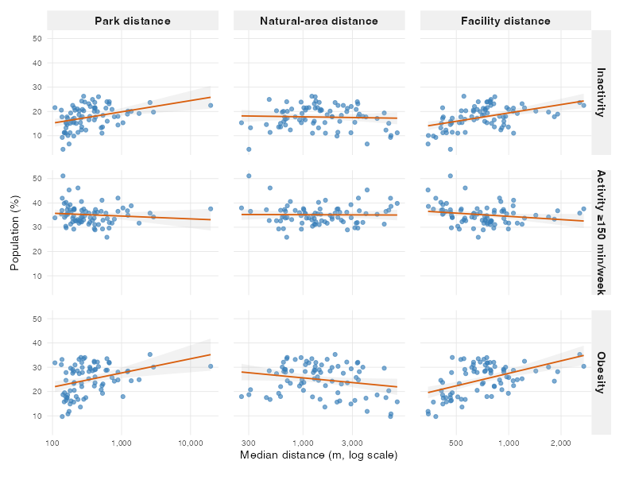

---
title: Recreational Spaces and Health Outcomes Across Victoria
author: Nana Cheng, Kaiyi Ye, Jingyi Wang
date: today
toc: false
format:
  presentation-revealjs+letterbox:
    fontsize: 26px
    css: styles.css
---


```{r}
#| label: load-packages
#| include: false
library(knitr)
library(ggplot2)
library(dplyr)
library(tidyverse)
options(width = 70)
```


## Why Does Recreational Accessibility Matter?

**Does access to recreational spaces help explain differences in health?**

- Parks, natural areas and sports facilities provide opportunities for physical activity.

- Access to these spaces varies across communities in Victoria.

- Socioeconomic conditions and population density may also help explain differences in physical activity and health outcomes.

::: {.columns}

::: {.column width="50%"}

{height="420px"}

:::

::: {.column width="50%"}

{height="420px"}

:::

:::


## Research Questions

::: {style="font-size: 0.85em;"}

### Main Research Question

Does recreational accessibility explain additional variation in physical activity and health outcomes across Victoria, beyond socioeconomic conditions and population density?

### Specific Questions

1. How much variation is explained by socioeconomic conditions and population density?

2. Does adding recreational accessibility improve model fit?

3. Which accessibility dimensions provide the greatest additional explanatory power?

:::


## Study Area & Data Sources

::: {.columns}

::: {.column width="55%"}


**79 Local Government Areas**  

{width="100%"}

:::

::: {.column width="45%"}

### Data Sources

::: {style="font-size: 0.82em;"}

**Victorian Department of Health**

Population Health Survey (2023)

**Australian Bureau of Statistics**

Socioeconomic, population and Mesh Block data

**Department of Transport and Planning**

Planning zones and local government boundaries (2026)

**Department of Jobs, Skills, Industry and Regions**

Sport and Recreational Facilities (2024)

:::

:::

:::


## Key Variables {.variables-slide}

::: {.columns}

::: {.column width="32%" .variable-card .baseline-card}

### Socioeconomic & Demographic Characteristics

**Socioeconomic Conditions**

- SEIFA IRSAD (2021)
- Relative advantage and disadvantage

**Population Density**

- People per km² (2023)

:::

::: {.column width="32%" .variable-card .access-card}

### Recreational Accessibility

**Distance-based Measures**

- Nearest park
- Nearest natural area
- Nearest recreational facility
- Nearest indoor facility

**Facility-based Measures**

- Indoor facilities (%)
- Sport types available

:::

::: {.column width="32%" .variable-card .outcome-card}

### Physical Activity & Health

**Physical Activity**

- Inactivity(did not do any moderate to vigorous physical activity)
- Activity (≥150 min/week of moderate to vigorous physical activity)

**Health Outcomes**

- Obesity (BMI ≥30)
- High psychological distress
- Fair/poor self-rated health

:::

:::


## How Do We Measure Recreational Accessibility?

::: {.columns}

::: {.column width="55%"}

::: {.r-stack}

{.fragment .fade-out data-fragment-index="1" width="100%"}

{.fragment .fade-in data-fragment-index="1" width="100%"}

:::

:::

::: {.column width="45%"}

### Step 1: Locate Residents

- Use populated 2021 Census Mesh Blocks
- Represent residents using a point within each Mesh Block

### Step 2: Measure Distances

- Straight-line distance to the nearest recreational destination
- Parks, natural areas, recreational and indoor facilities

### Step 3: Aggregate

- Weight distances by Mesh Block population
- Calculate the population-weighted median for each LGA

:::

:::


## Recreational Accessibility Varies Across Victoria

::: {.columns}
::: {.column width="33%"}

### Parks


:::
::: {.column width="33%"}

### Natural areas


:::
::: {.column width="33%"}

### Facilities


:::
:::

Recreational accessibility varies substantially across Victorian LGAs, with different spatial patterns across recreational space types.

::: {.notes}
So first, we wanted to see what recreational accessibility actually looks like across Victoria. Here, we're showing the median distance to parks, natural areas and indoor facilities for all 79 LGAs. 

We can see that these patterns are not the same. An area that's relatively close to parks isn't necessarily close to natural areas or facilities. So already, this suggests that accessibility isn't just one single measure. 
:::

## Health Outcomes Also Vary Across Victoria


::: {.columns}
::: {.column width="33%"}

### Less-than-moderate activity

{width="100%"}

:::
::: {.column width="33%"}

### Moderate-to-Vigorous Physical Activity

{width="100%"}

:::
::: {.column width="33%"}

### Obesity (BMI ≥30)

{width="100%"}

:::
:::

Health outcomes also differ across Victorian LGAs.

::: {.notes}
Now let's move on our health outcomes. These maps show less-than-moderate activity, meeting the 150-minute physical activity guideline, and obesity. 

We can see that health outcomes also vary across Victorian LGAs, and the patterns are different. 

So, we've now seen that both recreational accessibility and health outcomes vary across Victoria. But does that mean they're actually associated?
:::

## Do Accessibility and Health Show Similar Spatial Patterns?

::: {.columns}
::: {.column width="50%"}

### Park distance


:::
::: {.column width="50%"}

### Less-than-moderate activity


:::
:::

Some LGAs with longer park distances also show higher inactivity, but the spatial patterns do not fully align.

::: {.notes}
Here, we're comparing park distance and inactivity across Victorian LGAs. We can see that some areas with longer distances to parks also have higher inactivity rates. We might notice some broad similarities, but there are differences as well.

This raises an interesting question: are poorer access tend to have worse health outcomes?

Since the visual comparisons can be misleading, we next examine the correlations between accessibility and health.
:::


## Which Accessibility Indicators Are Associated with Health?

::: {.columns}
::: {.column width="58%"}

<div style="margin-bottom: 10px;">

<h3 style="margin-bottom: 2px;">Accessibility–health correlations</h3>

<p style="font-size: 0.65em; color: grey; margin-top: 0;">
Unadjusted Spearman correlations: 6 accessibility indicators × 5 health outcomes
</p>

</div>


:::
::: {.column width="42%"}


**Inactivity**

- Park distance: $\rho$ = +0.42
- Facility distance: $\rho$ = +0.45

**Obesity**

- Facility distance: $\rho$ = +0.45
- Indoor facility distance: $\rho$ = +0.46

**Natural-area distance**

- Almost no unadjusted correlation with inactivity ($\rho$ = 0.00)

:::
:::

Accessibility–health associations vary across indicators and outcomes, with the clearest unadjusted patterns observed for inactivity and obesity.

::: {.notes}
This is our overall association picture. Each cell shows the Spearman correlation between one accessibility indicator and one health outcome. 

We can see that inactivity and obesity show the clearest patterns. LGAs that are further from parks and recreational facilities tend to have higher inactivity and obesity rates.

But not all indicators show the same pattern. The other health outcomes tend to show weaker or less consistent patterns. For example, natural-area distance has almost zero overall correlation with inactivity.

So different types of accessibility seem to be related to health in different ways. To get a clearer picture, let's take a closer look at some of these relationships using the actual LGA data.
:::


## Access–Health Associations Differ Across Indicators and Outcomes

::: {.columns}

::: {.column width="65%"}

{width="100%"}

:::

::: {.column width="35%"}


**Inactivity**

- Longer park and facility distances are associated with higher inactivity.

**Activity ≥150 min/week**

- No clear association with the three distance measures.

**Obesity**

- Longer park and facility distances are associated with higher obesity.
- Natural-area distance shows a different pattern.

:::
:::

::: {.notes}
If we look at inactivity in the first row, we can see that LGAs further away from parks and recreational facilities generally have higher inactivity. But for natural areas, the relationship is almost flat.

In the second row, for meeting the 150-minute physical activity guideline, the relationships are much weaker. There isn't a clear trend across these three accessibility measures.

For obesity in the third row, we see a similar pattern to inactivity. Greater distances to parks and facilities are generally associated with higher obesity. But natural-area distance shows a different, slightly negative trend.

So at this stage, we can say there's an association in some cases, but it certainly isn't a simple or universal pattern. Since these are still unadjusted relationships, other characteristics of LGAs may also help expalin these patterns.
:::


## Socioeconomic Conditions Are Related to Access and Health


::: {.columns}
::: {.column width="50%"}

### SEIFA vs accessibility

{height="340px"}

:::
::: {.column width="50%"}

### SEIFA vs health outcomes

{height="340px"}

:::
::: 

**Accessibility:** More advantaged LGAs tend to be closer to parks and recreational facilities, but further from natural areas.

**Health outcomes:** More advantaged LGAs tend to have lower inactivity, obesity, psychological distress and poor self-rated health.

Socioeconomic differences may partly explain the observed accessibility–health associations.

::: {.notes}
The socioeconomic advantage is one of the characteristics that we look at. SEIFA score is moderately correlated with most accessibility indicators, except for sport types. It also shows strong correlations with several health outcomes, especially inactivity and obesity.

This means some of the relationship we saw earlier might partly reflect differences in socioeconomic conditions between LGAs. This is something we need to consider when examining the relationship between accessibility and health.
:::


## Population Density Is Also Linked to Access and Health

::: {.columns}

::: {.column width="50%"}

### Population Density vs Accessibility

{width="100%"}

:::

::: {.column width="50%"}

### Population Density vs Health Outcomes

{width="100%"}

:::

:::

Denser LGAs tend to be nearer parks and facilities, and density is also associated with health outcomes.

::: {.notes}
Population density is another factor that may influence the patterns we observed. LGAs with higher population density generally have shorter distances to parks and recreational facilities, and a higher share of indoor facilities. They also tend to have lower inactivity and obesity rates.

So, just like SEIFA, population density may partly explain some of the the relationships we saw earlier between accessibility and health outcomes.
:::


## Accessibility Indicators Are Related but Not Identical

::: {.columns}

::: {.column width="60%"}

### Correlations among 6 access indicators

{width="100%"}

:::

::: {.column width="40%"}

### Strong overlap

**Park vs facility distance:** $\rho$ = +0.78

**Facility vs indoor distance:** $\rho$ = +0.78

Some distance indicators contain similar information.

### Distinct access dimension

**Park vs natural-area distance:** $\rho$ = −0.10

Natural-area accessibility cannot be assumed equivalent to park accessibility.

:::

:::

We should test both individual accessibility measures and several combined model specifications.

::: {.notes}
One final thing we noticed is that our accessibility measures are connected to each other.

As you can see, park and facility distances are strongly correlated, and the same is true for facility and indoor-facility distances. It means that, LGAs that are further away from one type of recreational space also tend to be further away from others.

However, natural-area distance shows much weaker correlations with these indicators. 

So, while some indicators seem to tell us similar things, others capture different aspects of accessibility. That's why it's important to look at more than just one indicator.
:::


## What Does Our EDA Tell Us?


### 1. Spatial Variation

Recreational accessibility varies across Victorian LGAs, with different patterns across space types.

### 2. Accessibility–Health Associations

Longer park and facility distances tend to be associated with higher inactivity and obesity.

### 3. Relationships Among Accessibility Indicators

Some indicators are strongly correlated, while natural-area distance shows relatively distinct patterns.

### 4. Socioeconomic and Geographic Differences

SEIFA and population density are associated with both accessibility and health outcomes.


**Next question:** Does recreational accessibility explain additional variation in health outcomes beyond SEIFA and population density?


::: {.notes}
So far, we found four main things from the data.

First, recreational accessibility varies quite a lot across Victoria, and different types of spaces show different patterns. Second, longer distances to parks and facilities tend to be linked to higher inactivity and obesity rates. Third, some accessibility indicators are strongly correlated with each other, while others show different patterns. And finally, we found that socioeconomy and population density are related to both accessibility and health outcomes.

So this brings us to our next question: once we've taken SEIFA and density into account,does recreational accessibility still help explain differences in health outcomes?

That's what we move on to in our regression results.
:::


## Our Modelling Strategy

```{css, echo=FALSE}
/* card */
.card {
  border: 1px solid #e0e0e0; 
  border-radius: 8px;       
  padding: 15px 20px;        
  margin-bottom: 10px;       
  background-color: #ffffff; 
  box-shadow: 0 2px 4px rgba(0,0,0,0.02); 
  position: relative;        
}

/* card title */
.card-title {
  font-size: 0.8em;
  font-weight: bold;
  margin-bottom: 8px;
  color: #222;
}

/* Label style in the top-right corner (M0 -> M1, M2, A/B/C) */
.badge {
  position: absolute;
  top: 14px;
  right: 15px;
  padding: 2px 10px;
  border-radius: 12px;
  font-size: 0.75em;
  font-weight: bold;
  font-family: monospace; 
}

.badge-blue { background-color: #e3f2fd; color: #1976d2; }
.badge-grey { background-color: #f5f5f5; color: #616161; }
.badge-green { background-color: #e8f5e9; color: #2e7d32; }

/* Adjust the spacing of the list within the card */
.card p, .card ul {
  margin-bottom: 5px;
  font-size: 0.8em;
  line-height: 1.4;
}

/* Arrow */
.arrow {
  text-align: center;
  color: #888;
  font-size: 1.0em;
  margin: -5px 0; 
}

/* Bottom Evaluation Section */
.eval-section {
  border-top: 1px solid #e0e0e0;
  padding-top: 15px;
  margin-top: 15px;
}

.eval-title {
  font-weight: bold;
  font-size: 1.0em;
  margin-bottom: 5px;
}
```


::: {.card}
::: {.badge .badge-blue}
M0 → M1
:::
::: {.card-title}
Baseline models
:::
M0: SEIFA 

M1: SEIFA + population density
:::

::: {.arrow}
<i class="fa-solid fa-arrow-down"></i>
:::

::: {.card}
::: {.badge .badge-grey}
M2
:::
::: {.card-title}
Individual accessibility models
:::
SEIFA + population density + only one accessibility indicator 
:::

::: {.arrow}
<i class="fa-solid fa-arrow-down"></i>
:::

::: {.card}
::: {.badge .badge-green}
A / B / C
:::
::: {.card-title}
Combined accessibility models
:::
A: SEIFA + population density + park–facility distance + natural-area distance + indoor-facility distance

B: SEIFA + population density + park distance + facility distances + natural-area distance + indoor-facility distances

C: SEIFA + population density + park distance + facility distances + natural-area distance + indoor-facility distances + Indoor facilities (%) + sport-type count
:::

::: {.eval-section}
<span style="color: #2e7d32; font-size: 1.0em;"><i class="fa-regular fa-circle-check"></i></span> <span class="eval-title">How did we evaluate the models?</span>

Adjusted R² for explanatory power, HC3 robust tests for statistical evidence, and diagnostic checks for reliability.
:::

## Main Results

:::: {.columns}
::: {.column width="60%"}
{width="100%"}
:::

::: {.column width="40%"}

**Main finding**

- Adding recreational accessibility (Selected Model A) significantly improved the explanatory power for inactivity (Adjusted $R^2$ increased from 0.612 to 0.713, $\Delta R^2 \approx 0.10$, HC3 joint test $p < 0.001$).

- For all other health outcomes (MVPA, obesity, psychological distress), adding accessibility indicators did not yield statistically significant improvements over the baseline model ($p>0.05$).

:::
::::

## What is associated with inactivity (less than moderate activity)?

**Selected Model A · outcome measured in percentage points**

Model A : SEIFA + population density + park-facility distance + natural-area distance + indoor-facility distance


::: {.columns}
::: {.column width="55%"}

$$
\begin{aligned}
\widehat{\text{Inactivity}}_i \text{ (\%)} ={} & 17.695 \\
& - 3.717\,\text{z\_seifa}_i \\
& - 0.542\,\text{z\_density}_i \\
& + 1.154\,\text{z\_parkfac}_i \\
& + 1.119\,\text{z\_nature}_i \\
& - 1.290\,\text{z\_indoor}_i
\end{aligned}
$$

where $\mathtt{z\_parkfac}_i = \frac{\mathtt{z\_park}_i + \mathtt{z\_facility}_i}{2}$, and $\varepsilon_i$ is the error term.

:::
::: {.column width="45%"}


| Predictor | Coefficient (95% HC3 CI) |
| :--- | :--- |
| SEIFA | -3.717<br>[-4.597, -2.836] |
| Population denisty | -0.542<br>[-1.827, 0.743] |
| Park/facility distance | +1.154<br>[+0.343, +1.964] |
| Natural-area distance | +1.119<br>[+0.433, +1.804] |
| Indoor-facility distance | -1.290<br>[-2.159, -0.421] |

:::
:::

## Interpretation & Robustness - Inactivity (Model A)

<style>
.result-box {
  border: 1px solid #e0e0e0;
  border-radius: 8px;
  padding: 18px 22px;
  margin-bottom: 15px;
  background-color: #ffffff;
  box-shadow: 0 2px 5px rgba(0,0,0,0.02);
}
.box-header {
  font-size: 0.95em;
  font-weight: bold;
  margin-bottom: 10px;
  color: #1a1a1a;
}
.math-text {
  font-family: "Times New Roman", Times, serif;
  font-size: 1.0em;
  font-weight: bold;
  margin: 5px 0 10px 0;
  color: #111;
}
.box-text {
  font-size: 0.8em;
  line-height: 1.45;
  color: #333;
}
.box-subtext {
  font-size: 0.75em;
  color: #777;
  margin-top: 6px;
}

.model-checks-box {
  border: 1px solid #d0d0d0; 
  border-radius: 8px; 
  padding: 15px 22px; 
  background-color: #fafafa; 
  margin-top: 10px;
}
.model-checks-title {
  font-size: 0.9em; 
  font-weight: bold; 
  margin-bottom: 15px; 
  color: #1a1a1a; 
  border-bottom: 1px solid #e0e0e0; 
  padding-bottom: 8px;
}
.check-item {
  font-size: 0.8em;
  color: #333;
  margin-bottom: 12px;
  line-height: 1.45;
}
.check-item strong {
  color: #1a1a1a;
  display: block;
  margin-bottom: 2px;
}
</style>

::: {.result-box}
<div class="box-header">📈 1. Socioeconomic advantage matters</div>
<div class="math-text">β = −3.717</div>
<div class="box-text"> Higher SEIFA was associated with lower inactivity in Model A (95% CI: −4.597 to −2.836). </div>
:::

::: {.result-box}
<div class="box-header">🌱 2. Accessibility is associated with inactivity</div>
<div class="box-text"> Greater park/facility distance (β = 1.154) and natural-area distance (β = 1.119) were associated with higher inactivity. </div>
<div class="box-subtext"> Conversely, living further from indoor facilities was associated with lower inactivity (β = −1.290). </div>
:::

::: {.model-checks-box}
<div class="model-checks-title">Model checks & Robustness</div>

<div class="check-item">
<strong>📊 3. Regression diagnostics</strong>
Adj. $R^2$ = 0.713, $\Delta R^2$ = 0.100 over baseline. No severe multicollinearity was detected (max VIF = 3.98). HC3 joint test $p < 0.001$.
</div>

<div class="check-item">
<strong>✅ 4. Robustness (Leave-one-LGA-out)</strong>
The model fit remained highly stable across all leave-one-LGA-out checks (Adj. $R^2$ ranged from 0.688 to 0.735). 
</div>

<div class="check-item" style="margin-bottom: 0;">
<strong>🌐 5. Spatial dependence</strong>
Residual spatial autocorrelation was tested across the 79 LGAs. No statistically significant spatial dependence remained in Model A (Moran’s I = −0.012, p = 0.994), indicating the model successfully accounted for spatial clustering.
</div>
:::

---

## Discussion

::: {.columns}
::: {.column width="30%"}

**RQ1 — Baseline explanatory power**

- SEIFA explained varying proportions of outcome variation.

- Population density added the most explanatory power for psychological distress (adjusted $R^2$: 0.272 → 0.317), but contributed little for inactivity and MVPA.

Socioeconomic conditions and population density explained different amounts of variation across health outcomes.

:::
::: {.column width="30%"}

**RQ2 — Does accessibility add explanatory power?**

- **Inactivity: yes**. Adj. $R^2$ increased from 0.612 to 0.713 (HC3 robust joint test, $p < 0.001$).
- **MVPA, obesity and psychological distress:** Adjusted R² improved only slightly, with no significant HC3 joint contribution.
- **Fair/poor self-rated health:** Accessibility did not improve the selected model.

Accessibility provided substantial additional explanatory power for inactivity, but evidence was limited for the other health outcomes.


:::
::: {.column width="30%"}

**RQ3 — Which dimensions matter?**

For inactivity, Model A showed the clearest joint contribution from accessibility indicators.

Natural-area distance was positively associated with inactivity, while indoor-facility distance showed an inverse association.

No accessibility dimension was consistently important across all five health outcomes.

:::
:::


## Planning implications

- Consider the location of recreational spaces alongside their availability.
- Assess whether local provision aligns with community needs.
- Treat these findings as evidence of area-level associations, not proof that improving access will reduce inactivity.


## Limitations

- **LGA-level analysis** 

Results describe area-level patterns, not individual behaviour.

- **Cross-sectional data** 

The data capture variables at a single point in time, so the analysis can only identify associations between variables and cannot establish causal effects or capture changes over time.

- **Accessibility measures** 

Straight-line distance does not capture actual travel time, facility quality, affordability, opening hours or personal preferences.

- **Residual spatial dependence** 

Significant spatial autocorrelation remained in the MVPA model (Moran's I = 0.144, p = 0.028), so its findings require caution.


## Conclusion

**Main question:** Does recreational accessibility help explain differences in physical activity and health outcomes across Victorian LGAs, beyond socioeconomic advantage and population density?

- **Socioeconomic advantage** was an important explanatory factor, while population density added value mainly for psychological distress.
- **Recreational accessibility clearly added explanatory value for inactivity**, but not consistently for other outcomes.
- **Natural-area distance and indoor-facility share** were notable in the inactivity analysis, although no single dimension was universally dominant.

Overall, accessibility appeared **more informative for inactivity than for the other health outcomes examined**.

Further research could use more detailed accessibility measures and methods that account for spatial dependence.


# Thank you