---
title: Recreational Spaces and Health Outcomes Across Victoria
author: Nana Cheng, Kaiyi Ye, Jingyi Wang
date: today
toc: false
format:
  presentation-revealjs+letterbox:
    fontsize: 26px
    css: styles.css
---


```{r}
#| label: load-packages
#| include: false
library(knitr)
library(ggplot2)
library(dplyr)
library(tidyverse)
options(width = 70)
```


## Why Does Recreational Accessibility Matter?

**Does access to recreational spaces help explain differences in health?**

- Parks, natural areas and sports facilities provide opportunities for physical activity.

- Access to these spaces varies across communities in Victoria.

- Socioeconomic conditions and population density may also help explain differences in physical activity and health outcomes.

::: {.columns}

::: {.column width="50%"}

{height="420px"}

:::

::: {.column width="50%"}

{height="420px"}

:::

:::

::: {.notes}

Let's take a look at these two maps of Victoria.
The map on the left shows the distribution of parks and conservation areas, while the map on the right shows physical activity levels across different areas.
We can see that recreational spaces are not evenly distributed, and physical activity levels also vary across Victoria.
But having recreational spaces in an area doesn't necessarily mean everyone can easily reach them. This is where recreational accessibility becomes important.
At the same time, physical activity and health outcomes may also be related to socioeconomic conditions and population density.


:::


## Research Questions

::: {style="font-size: 0.85em;"}

### Main Research Question

Does recreational accessibility explain additional variation in physical activity and health outcomes across Victoria, beyond socioeconomic conditions and population density?

### Specific Questions

1. How much variation is explained by socioeconomic conditions and population density?

2. Does adding recreational accessibility improve model fit?

3. Which accessibility dimensions provide the greatest additional explanatory power?

:::

::: {.notes}

So, we want to investigate whether recreational accessibility can explain additional variation in physical activity and health outcomes, beyond these other factors.


We focus on three specific questions.
These questions guide our modelling approach.


:::


## Study Area & Data Sources

::: {.columns}

::: {.column width="55%"}

**79 Local Government Areas**

{width="100%"}

:::

::: {.column width="45%"}

### Data Sources

::: {style="font-size: 0.82em;"}

**Health Data**

- Physical activity and health outcomes
- Source: Victorian Department of Health (2023)

**Socioeconomic & Population Data**

- SEIFA, population and Mesh Blocks
- Source: Australian Bureau of Statistics

**Spatial & Recreational Data**

- Parks, natural areas and LGA boundaries
- Source: Department of Transport and Planning
- Sports and recreational facilities
- Source: Department of Jobs, Skills, Industry and Regions

:::

:::

:::


::: {.notes}

Our study covers 79 Local Government Areas across Victoria, as shown on the map.
A Local Government Area is an administrative region managed by a local council, and each area represents one observation in our analysis.
We combine several government datasets, with the sources listed on the right.
For recreational spaces, we distinguish between three categories.
First, public parks,                         identified using Public Park and Recreation Zones.
Second, natural areas,                  identified using Public Conservation and Resource Zones.
Both are derived from planning zone data.
Third, sports and recreational facilities, such as football fields, tennis courts and swimming pools.
These categories form the basis of our recreational accessibility measures.


:::


## Key Variables {.variables-slide}

::: {.columns}

::: {.column width="32%" .variable-card .baseline-card}

### Socioeconomic & Demographic Characteristics

**Socioeconomic Conditions**

- SEIFA IRSAD (2021)
- Relative advantage and disadvantage

**Population Density**

- People per km² (2023)

:::

::: {.column width="32%" .variable-card .access-card}

### Recreational Accessibility

**Distance-based Measures**

- Nearest park
- Nearest natural area
- Nearest recreational facility
- Nearest indoor facility

**Facility-based Measures**

- Indoor facilities (%)
- Sport types available

:::

::: {.column width="32%" .variable-card .outcome-card}

### Physical Activity & Health

**Physical Activity**

- Inactivity(did not do any moderate to vigorous physical activity)
- Activity (≥150 min/week of moderate to vigorous physical activity)

**Health Outcomes**

- Obesity (BMI ≥30)
- High psychological distress
- Fair/poor self-rated health

:::

:::


::: {.notes}

This slide shows the three groups of variables used in our analysis.

First, socioeconomic and demographic characteristics, including SEIFA and population density.
Second, recreational accessibility, measured using distances to recreational spaces, indoor facility percentages, and available sport types
Finally, physical activity and health outcomes, including inactivity, sufficient physical activity, obesity, psychological distress, and self-rated health.

Now that we know which variables we use, the next question is how we actually measure recreational accessibility.


:::

## How Do We Measure Recreational Accessibility?

::: {.columns}

::: {.column width="55%"}

::: {.r-stack}

{.fragment .fade-out data-fragment-index="1" width="100%"}

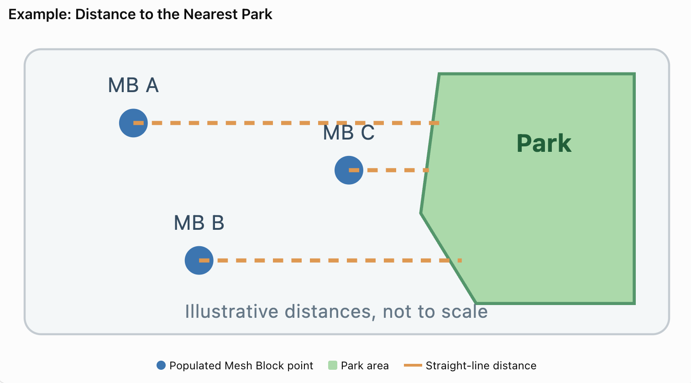{.fragment .fade-in data-fragment-index="1" width="100%"}

:::

:::

::: {.column width="45%"}

### Step 1: Locate Residents

- Use populated 2021 Census Mesh Blocks
- Represent residents using a point within each Mesh Block

### Step 2: Measure Distances

- Straight-line distance to the nearest recreational destination
- Parks, natural areas, recreational and indoor facilities

### Step 3: Aggregate

- Weight distances by Mesh Block population
- Calculate the population-weighted median for each LGA

:::

:::

::: {.notes}

First, we use Mesh Blocks. These are small geographic areas.
For example, as shown on the left, the Monash Local Government Area contains 2,335 Mesh Blocks.
We use one representative point within each populated Mesh Block to approximate where residents live.


Next, we calculate the straight-line distance from each point to the nearest recreational destination.
As shown in the diagram, the orange dashed lines represent the distances from Mesh Block points to the nearest park.
We repeat this for natural areas, recreational facilities and indoor facilities.
Finally, we combine these distances using a population-weighted median for each Local Government Area.
This means Mesh Blocks with more residents have more weight in the calculation.
In this way, we obtain four distance-based accessibility measures for each area.


:::

## Exploring the Data {.center}


## Recreational Accessibility Varies Across Victoria

::: {.columns}
::: {.column width="33%"}

### Parks

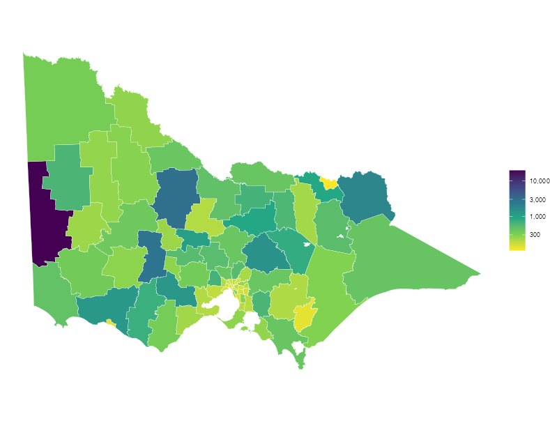

:::
::: {.column width="33%"}

### Facilities

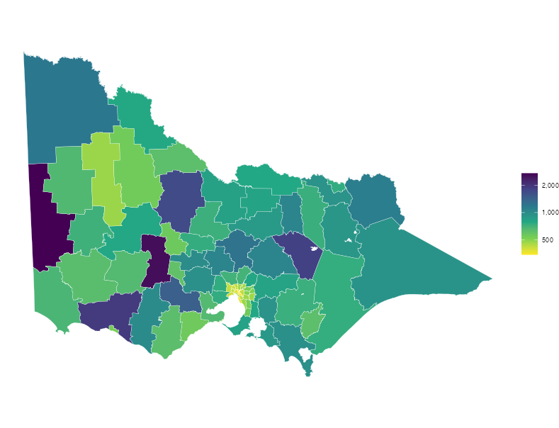

:::
::: {.column width="33%"}

### Natural areas

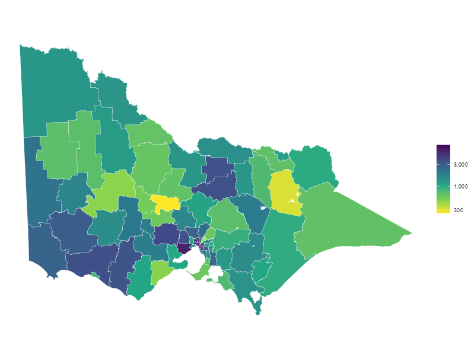


:::
:::

<span style="font-size: 0.65em; color: grey;">Darker colours indicate longer distances (poorer accessibility).</span>

Recreational accessibility varies substantially across Victorian LGAs, with different spatial patterns across recreational space types.

::: {.notes}
So first, let's look at recreational accessibility across Victoria.

These maps show the median distance to parks, natural areas and recreational facilities across the LGAs. Darker colours mean longer distances.

If we look at the bottom centre of the maps, this area is generally lighter on the park and facility maps, but it is much darker on the natural-area map, suggesting that people here tend to have shorter distance to parks and facilities, but longer distance to natural areas.
:::

## Health Outcomes Also Vary Across Victoria


::: {.columns}
::: {.column width="33%"}

### Inactivity

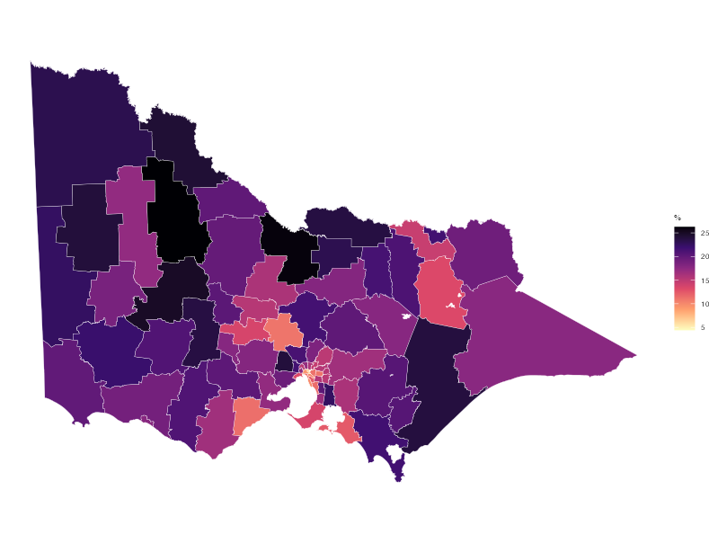{width="100%"}

:::
::: {.column width="33%"}

### Activity

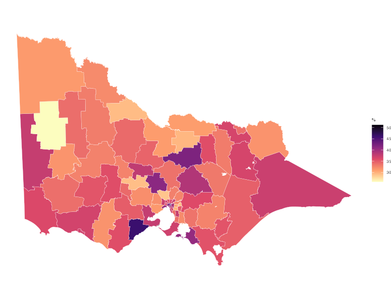{width="100%"}

:::
::: {.column width="33%"}

### Obesity

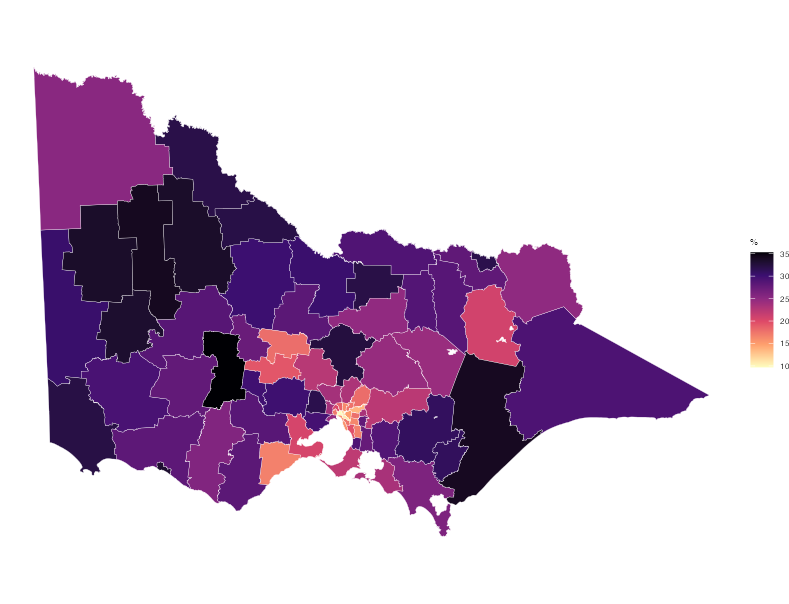{width="100%"}

:::
:::

Health outcomes also differ across Victorian LGAs.

::: {.notes}
These maps show inactivity, activity, and obesity. 

We can see that health outcomes also vary across Victorian LGAs. 

So, we've now seen that both recreational accessibility and health outcomes differ between LGAs. But the question is, are they actually related?
:::

## Do Accessibility and Health Show Similar Spatial Patterns? {visibility="hidden"}

::: {.columns}
::: {.column width="50%"}

### Park distance


<span style="font-size: 0.6em; color: grey;">Darker = longer distance to parks (poorer access)</span>

:::
::: {.column width="50%"}

### Inactivity


<span style="font-size: 0.6em; color: grey;">Darker = higher inactivity rate</span>
:::
:::

Visual comparisons suggest possible spatial overlap: some LGAs with longer park distances also show higher inactivity.

::: {.notes}
Let's put the accessibility and the health outcome together. Here, we're comparing park distance and inactivity. 

We can see that some areas with longer distances to parks also have higher inactivity rates. But the patterns don't match perfectly. And it's difficult to judge the strength of a relationship just by comparing maps.

So rather than relying on visual impressions, we calculated correlations between all six accessibility indicators and all five health outcomes.
:::


## Which Accessibility Indicators Are Associated with Health Outcomes? {visibility="hidden"}

::: {.columns}

::: {.column width="65%"}

<div style="margin-bottom: 10px;">

<h3 style="margin-bottom: 2px;">Accessibility–health correlations</h3>

<p style="font-size: 0.65em; color: grey; margin-top: 0;">
Unadjusted Spearman correlations: 6 accessibility indicators × 5 health outcomes
</p>

</div>


:::

::: {.column width="35%"}

**Outcomes:** Inactivity and obesity show the clearest associations with accessibility. Other outcomes show weaker or less consistent associations.

**Accessibility:** Park and facility distances show similar patterns, while natural-area distance behaves differently.

Associations vary across accessibility indicators and health outcomes.

:::

::: 

::: {.notes}
This is the overall picture of the relationship between accessibility and health outcomes.

Looking across the outcomes, we can see that the clearest associations are generally found for inactivity and obesity. But for other health outcomes, the relationships are much weaker or less consistent.

Looking across the accessibility indicators, park and facility distances show similar patterns, while natural-area distance behaves differently.

So the main finding here is that the relationship depends on both the type of recreational space and the health outcome.
:::


## How Is Recreational Accessibility Related to Health Outcomes?

<p style="font-size: 0.65em; color: grey; margin-top: 0;">
Four selected relationships highlighting clearer associations and contrasting patterns.
</p>

::: {.columns}

::: {.column width="35%"}

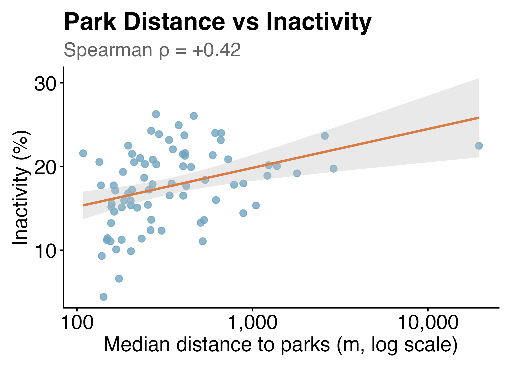{height="280px"}

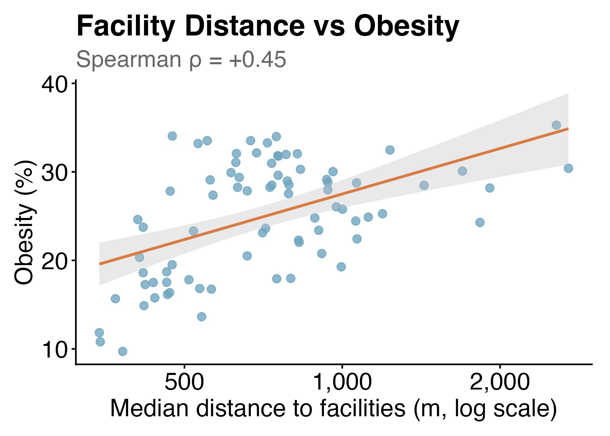{height="280px"}

:::

::: {.column width="35%"}

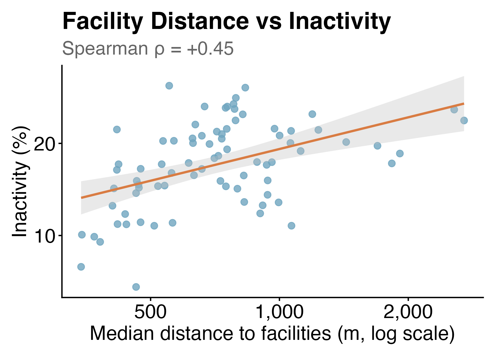{height="280px"}

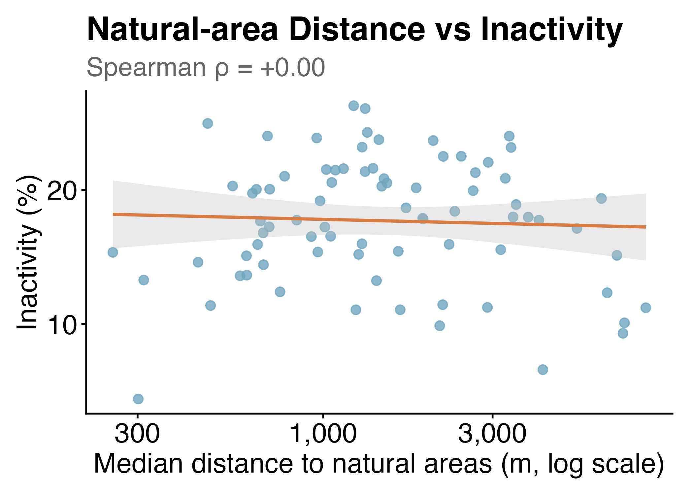{height="280px"}

:::

::: {.column width="30%"}

#### Positive associations

Longer park and facility distances tend to be associated with higher inactivity and obesity.

#### Contrasting pattern
Natural-area distance has almost no unadjusted correlation with inactivity.

#### Variation between LGAs

Similar accessibility does not always mean similar health outcomes.

:::

:::

::: {.notes}
Now, let's look at the relationships between accessibility and health outcomes. 

Here we're focusing on the relationships that to show the clearest associations and some contrasting patterns.

Each dots represent one LGA, and the lines show the overall trends.

In the first three plots, we can see that LGAs with longer distances to parks and facilities tend to have higher inactivity and obesity rates. But the last plot shows a different pattern that natural-area distance has almost no overall relationship with inactivity.

Another thing we can notice is that the points are quite spread out in all plots. So LGAs with similar accessibility can have quite different health outcomes.

This suggests that accessibility alone doesn't fully explain the differences between LGAs. So this brings us to another question: what other characteristics of LGAs might be related to these patterns?
:::


## Socioeconomic Conditions Are Related to Access and Health


::: {.columns}
::: {.column width="47%"}

#### SEIFA vs accessibility

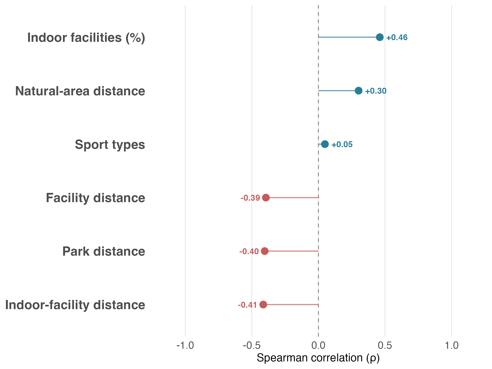

More advantaged LGAs: closer to parks and recreational facilities, but further from natural areas.

:::

::: {.column width="6%"}
:::


::: {.column width="47%"}

#### SEIFA vs health outcomes

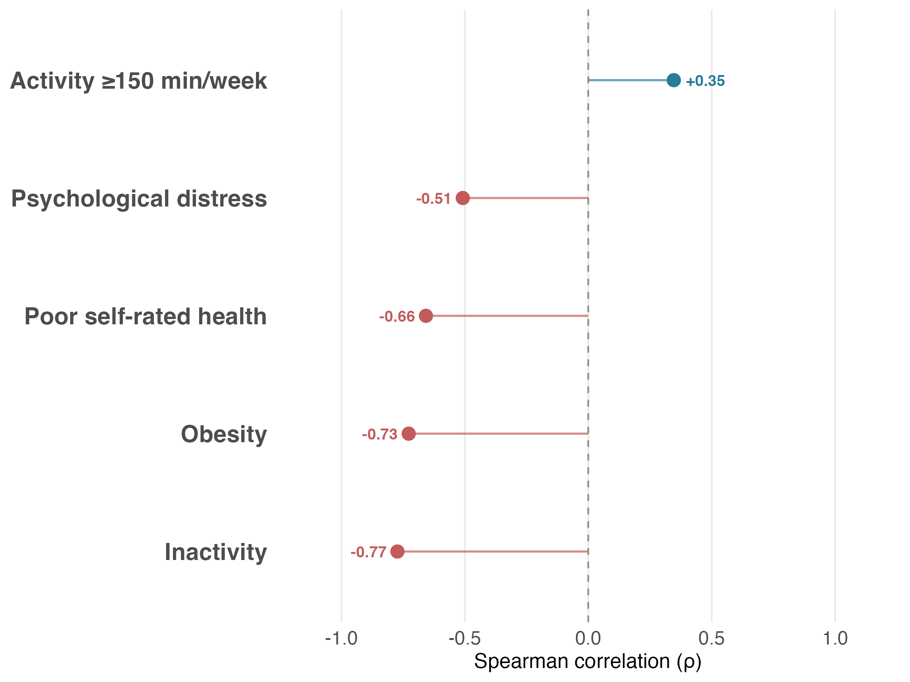

More advantaged LGAs: lower inactivity, obesity, psychological distress and poor self-rated health.

:::
::: 

Socioeconomic differences may partly explain the earlier observed accessibility–health associations.

::: {.notes}
One possible explanation is socioecnomic differences. 

On the left, more advantaged LGAs tend to be closer to parks and facilities, but further from natural areas.

On the right, they also tend to have lower inactivity and obesity rates.

Therefore, socioeconomic differences might partly explain the relationships we saw earlier.
:::


## Population Density Is Also Linked to Access and Health

::: {.columns}

::: {.column width="50%"}

#### Population Density vs Accessibility

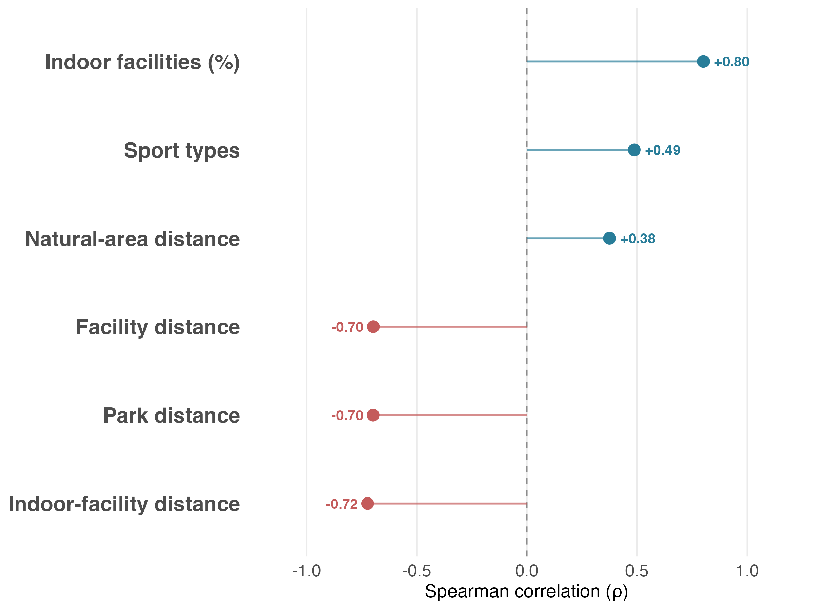{width="100%"}

:::

::: {.column width="50%"}

#### Population Density vs Health Outcomes

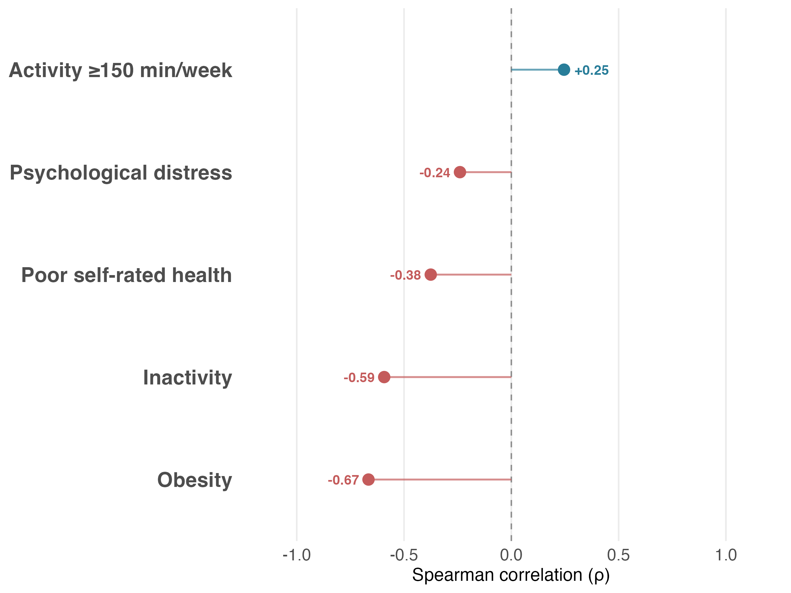{width="100%"}

:::

:::

Denser LGAs tend to be closer to parks and facilities, and have better health outcomes. 

::: {.notes}
Population density shows a very similar pattern.

Therefore, both SEIFA and population density may be important when examining accessibility and health.
:::


## Accessibility Indicators Are Related but Not Identical

::: {.columns}

::: {.column width="60%"}

#### Correlations among 6 access indicators

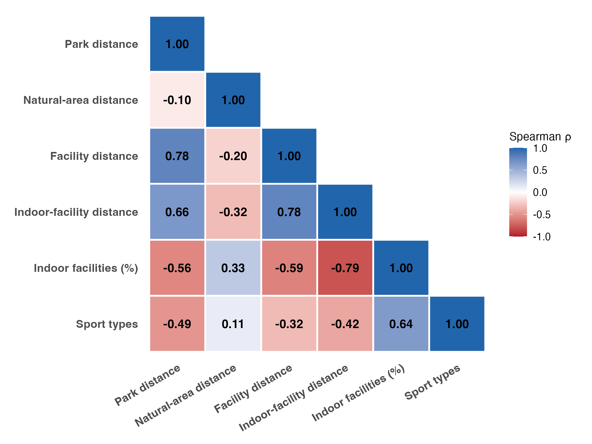{width="100%"}

:::

::: {.column width="40%"}

#### Strong correlations

**Park vs facility distance:** $\rho$ = +0.78

**Facility vs indoor distance:** $\rho$ = +0.78

These measures provide similar information.


#### Distinct pattern

**Park vs natural-area distance:** $\rho$ = −0.10

Natural-area distance shows a different pattern from other distance measures.

:::

:::

::: {.notes}
Finally, we looked at how the accessibility measures relate to each other.

As you can see, park and facility distances are strongly correlated. It means that, LGAs that are closer to parks also tend to be closer to facilities.  

And so are facility and indoor-facility distances. These correlated indicators give us similar information.

But natural-area distance is different.  It shows much weaker correlations with others, suggesting that it tells us something different.

:::


## What Did We Learn from Our EDA?

### 1. Accessibility is multidimensional

Accessibility varies across LGAs, with some indicators showing overlapping patterns and others capturing distinct dimensions.

### 2. Associations differ across outcomes

Longer park and facility distances are generally associated with higher inactivity and obesity, but other associations are weaker or less consistent.

### 3. Broader LGA characteristics matter

SEIFA and population density are related to both accessibility and health outcomes.


**Next question:** Does recreational accessibility explain additional variation in health outcomes beyond SEIFA and population density?


::: {.notes}
So far, the data tell us three main things.

First, different accessibility measures don't always show the same patterns.
Second, longer distances to parks and facilities tend to be linked to higher inactivity and obesity. 
And finally, socioeconomy and population density are related to both accessibility and health outcomes.

So the next question is: does accessibility still help explain differences in health outcomes after accounting for these two factors?
Let's move on to our modelling part.
:::


## Regression Modelling {.center}

## Our Modelling Strategy

```{css, echo=FALSE}
/* card */
.card {
  border: 1px solid #e0e0e0; 
  border-radius: 8px;       
  padding: 15px 20px;        
  margin-bottom: 10px;       
  background-color: #ffffff; 
  box-shadow: 0 2px 4px rgba(0,0,0,0.02); 
  position: relative;        
}

/* card title */
.card-title {
  font-size: 0.8em;
  font-weight: bold;
  margin-bottom: 8px;
  color: #222;
}

/* Label style in the top-right corner (M0 -> M1, M2, A/B/C) */
.badge {
  position: absolute;
  top: 14px;
  right: 15px;
  padding: 2px 10px;
  border-radius: 12px;
  font-size: 0.75em;
  font-weight: bold;
  font-family: monospace; 
}

.badge-blue { background-color: #e3f2fd; color: #1976d2; }
.badge-grey { background-color: #f5f5f5; color: #616161; }
.badge-green { background-color: #e8f5e9; color: #2e7d32; }

/* Adjust the spacing of the list within the card */
.card p, .card ul {
  margin-bottom: 5px;
  font-size: 0.8em;
  line-height: 1.4;
}

/* Arrow */
.arrow {
  text-align: center;
  color: #888;
  font-size: 1.0em;
  margin: -5px 0; 
}

/* Bottom Evaluation Section */
.eval-section {
  border-top: 1px solid #e0e0e0;
  padding-top: 15px;
  margin-top: 15px;
}

.eval-title {
  font-weight: bold;
  font-size: 1.0em;
  margin-bottom: 5px;
}
```


::: {.card}
::: {.badge .badge-blue}
M0 → M1
:::
::: {.card-title}
Baseline models
:::
M0: SEIFA 

M1: SEIFA + population density
:::

::: {.arrow}
<i class="fa-solid fa-arrow-down"></i>
:::

::: {.card}
::: {.badge .badge-grey}
M2
:::
::: {.card-title}
Individual accessibility models
:::
SEIFA + population density + only one accessibility indicator 
:::

::: {.arrow}
<i class="fa-solid fa-arrow-down"></i>
:::

::: {.card}
::: {.badge .badge-green}
A / B / C
:::
::: {.card-title}
Combined accessibility models
:::
A: SEIFA + population density + park–facility distance + natural-area distance + indoor-facility distance

B: SEIFA + population density + park distance + facility distances + natural-area distance + indoor-facility distances

C: SEIFA + population density + park distance + facility distances + natural-area distance + indoor-facility distances + Indoor facilities (%) + sport-type count
:::

::: {.eval-section}
<span style="color: #2e7d32; font-size: 1.0em;"><i class="fa-regular fa-circle-check"></i></span> <span class="eval-title">How did we evaluate the models?</span>

Adjusted R² for explanatory power, HC3 robust tests for statistical evidence, and diagnostic checks for reliability.
:::

## Main Results

:::: {.columns}
::: {.column width="60%"}
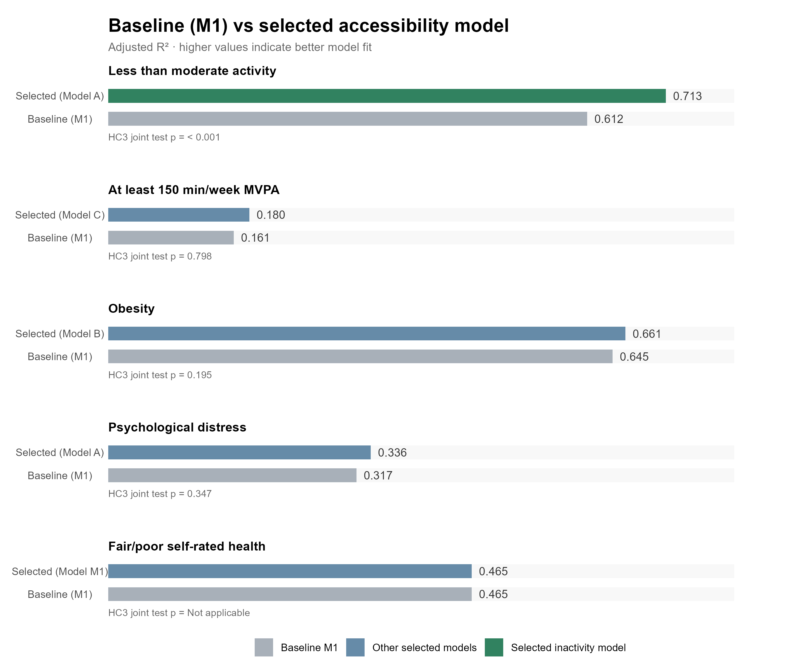{width="100%"}
:::

::: {.column width="40%"}

**Main finding**

- Adding recreational accessibility (Selected Model A) significantly improved the explanatory power for inactivity (Adjusted $R^2$ increased from 0.612 to 0.713, $\Delta R^2 \approx 0.10$, HC3 joint test $p < 0.001$).

- For all other health outcomes (MVPA, obesity, psychological distress), adding accessibility indicators did not yield statistically significant improvements over the baseline model ($p>0.05$).

:::
::::

## What is associated with inactivity (less than moderate activity)?

**Selected Model A · outcome measured in percentage points**

Model A : SEIFA + population density + park-facility distance + natural-area distance + indoor-facility distance


::: {.columns}
::: {.column width="55%"}

$$
\begin{aligned}
\widehat{\text{Inactivity}}_i \text{ (\%)} ={} & 17.695 \\
& - 3.717\,\text{z\_seifa}_i \\
& - 0.542\,\text{z\_density}_i \\
& + 1.154\,\text{z\_parkfac}_i \\
& + 1.119\,\text{z\_nature}_i \\
& - 1.290\,\text{z\_indoor}_i
\end{aligned}
$$

where $\mathtt{z\_parkfac}_i = \frac{\mathtt{z\_park}_i + \mathtt{z\_facility}_i}{2}$, and $\varepsilon_i$ is the error term.

:::
::: {.column width="45%"}


| Predictor | Coefficient (95% HC3 CI) |
| :--- | :--- |
| SEIFA | -3.717<br>[-4.597, -2.836] |
| Population denisty | -0.542<br>[-1.827, 0.743] |
| Park/facility distance | +1.154<br>[+0.343, +1.964] |
| Natural-area distance | +1.119<br>[+0.433, +1.804] |
| Indoor-facility distance | -1.290<br>[-2.159, -0.421] |

:::
:::

## Interpretation & Robustness - Inactivity (Model A)

<style>
.result-box {
  border: 1px solid #e0e0e0;
  border-radius: 8px;
  padding: 18px 22px;
  margin-bottom: 15px;
  background-color: #ffffff;
  box-shadow: 0 2px 5px rgba(0,0,0,0.02);
}
.box-header {
  font-size: 1.0em;
  font-weight: bold;
  margin-bottom: 10px;
  color: #1a1a1a;
}
.math-text {
  font-family: "Times New Roman", Times, serif;
  font-size: 1.0em;
  font-weight: bold;
  margin: 5px 0 10px 0;
  color: #111;
}
.box-text {
  font-size: 0.85em;
  line-height: 1.45;
  color: #333;
}
.box-subtext {
  font-size: 0.85em;
  color: #777;
  margin-top: 6px;
}

.model-checks-box {
  border: 1px solid #d0d0d0; 
  border-radius: 8px; 
  padding: 15px 22px; 
  background-color: #fafafa; 
  margin-top: 10px;
}
.model-checks-title {
  font-size: 1.0em; 
  font-weight: bold; 
  margin-bottom: 15px; 
  color: #1a1a1a; 
  border-bottom: 1px solid #e0e0e0; 
  padding-bottom: 8px;
}
.check-item {
  font-size: 0.85em;
  color: #333;
  margin-bottom: 12px;
  line-height: 1.45;
}
.check-item strong {
  color: #1a1a1a;
  display: block;
  margin-bottom: 2px;
}
</style>

::: {.result-box}
<div class="box-header">📈 1. Socioeconomic advantage matters</div>
<div class="math-text">β = −3.717</div>
<div class="box-text"> Higher SEIFA was associated with lower inactivity in Model A (95% CI: −4.597 to −2.836). </div>
:::

::: {.result-box}
<div class="box-header">🌱 2. Accessibility is associated with inactivity</div>
<div class="box-text"> Greater park/facility distance (β = 1.154) and natural-area distance (β = 1.119) were associated with higher inactivity. </div>
<div class="box-subtext"> Conversely, living further from indoor facilities was associated with lower inactivity (β = −1.290). </div>
:::

::: {.model-checks-box}
<div class="model-checks-title">Model checks & Robustness</div>

<div class="check-item">
<strong>📊 3. Regression diagnostics</strong>
Adj. $R^2$ = 0.713, $\Delta R^2$ = 0.100 over baseline. No severe multicollinearity was detected (max VIF = 3.98). HC3 joint test $p < 0.001$.
</div>

<div class="check-item">
<strong>✅ 4. Robustness (Leave-one-LGA-out)</strong>
The model fit remained highly stable across all leave-one-LGA-out checks (Adj. $R^2$ ranged from 0.688 to 0.735). 
</div>
:::

---

## Discussion

::: {.columns}
::: {.column width="33%"}

**RQ1 — Baseline explanatory power**

- SEIFA and population density explained different patterns across health outcomes.

:::
::: {.column width="33%"}

**RQ2 — Does accessibility add explanatory power?**

- **Inactivity: yes**. Clear additional explanatory value.
- **Activity, obesity and psychological distress:** Adjusted R² improved only slightly, with no significant HC3 joint contribution.
- **Fair/poor self-rated health:** Accessibility did not improve the selected model.


:::
::: {.column width="33%"}

**RQ3 — Which dimensions matter?**

- Different distance measures showed different associations with inactivity.

- No single accessibility dimension was consistently important across all outcomes.

:::
:::


## Limitations

- **LGA-level analysis** 

Results describe area-level patterns, not individual behaviour.

- **Cross-sectional data** 

The data capture variables at a single point in time, so the analysis can only identify associations between variables and cannot establish causal effects or capture changes over time.

- **Accessibility measures** 

Straight-line distance does not capture actual travel time, facility quality, affordability, opening hours or personal preferences.


## Conclusion

**Main question:** Does recreational accessibility help explain differences in physical activity and health outcomes across Victorian LGAs, beyond socioeconomic advantage and population density?

- **Yes, for inactivity:** Accessibility added significant explanatory value beyond socioeconomic advantage and population density.

- **Not consistently for other outcomes:** The additional explanatory value was limited, and the findings show associations rather than causal effects.

Overall, accessibility appeared **more informative for inactivity than for the other health outcomes examined**.


## Thank You! {style="text-align: center; margin-top: 110px; font-size: 1.8em; color: #17365D;"}

### Questions & Discussion {style="text-align: center; font-size: 1.1em; color: #17365D; margin-top: 25px;"}

::: {style="text-align: center; margin-top: 40px; font-size: 0.75em; color: #555555;"}
Recreational Spaces and Health Outcomes Across Victoria

Nana Cheng · Kaiyi Ye · Jingyi Wang
:::

