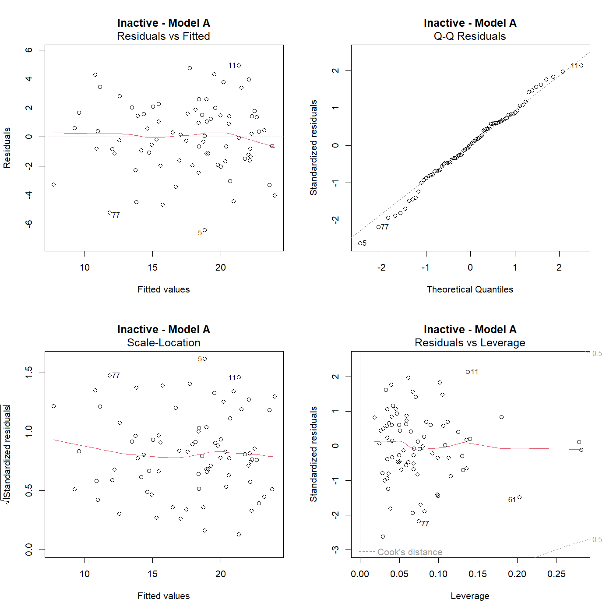
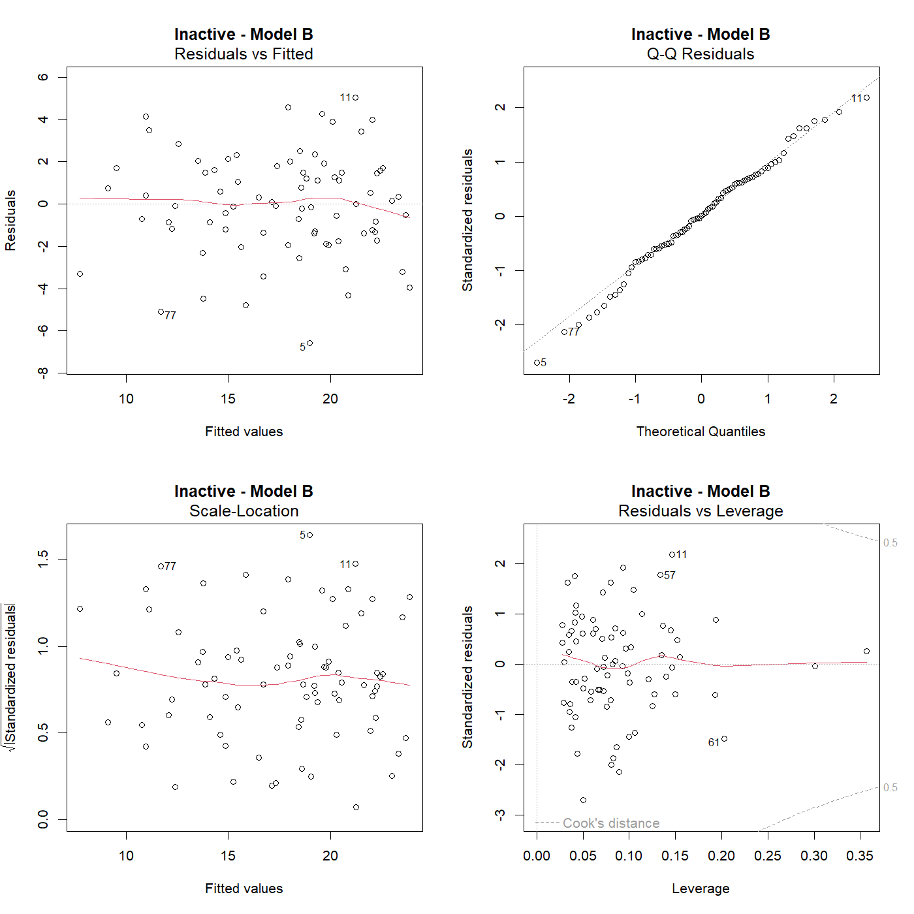
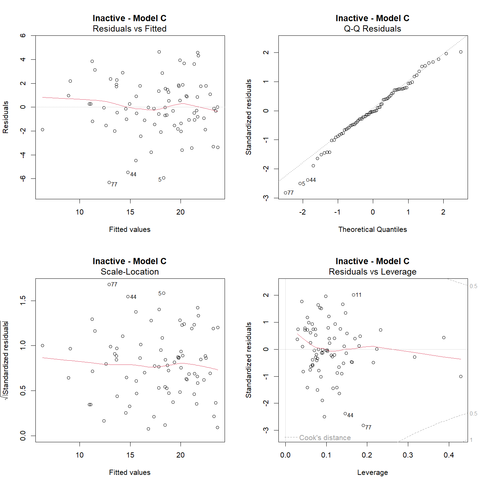

---
title: '\textbf{Recreational Space Accessibility and Health Outcomes Across Victorian LGAs}'
subtitle: "ETC5543 Research Project"

author:
  - "Nana Cheng"
  - "Jingyi Wang"
  - "Kaiyi Ye"

date: "30 October 2026"
date-format: "DD MMMM YYYY"
lang: en-AU

format:
  pdf:
    documentclass: article
    classoption: titlepage
    pdf-engine: xelatex

    # Page layout
    papersize: a4
    geometry:
      - top=2.5cm
      - bottom=2.5cm
      - left=2.5cm
      - right=2.5cm

    # Font and text
    fontsize: 11pt
    mainfont: "Times New Roman"
    linestretch: 1.5
    indent: false

    # Table of contents
    toc: false
    number-sections: true
    number-depth: 3

    # Headings and TOC formatting
    include-in-header:
      text: |
        \usepackage{float}
        \usepackage{caption}
        \usepackage{titlesec}

        % Section heading
        \titleformat{\section}
          {\normalfont\fontsize{20}{25}\selectfont\bfseries}
          {\thesection}{1em}{}

        % Subsection heading
        \titleformat{\subsection}
          {\normalfont\fontsize{14}{18}\selectfont\bfseries}
          {\thesubsection}{1em}{}

        % Subsubsection heading
        \titleformat{\subsubsection}
          {\normalfont\fontsize{12}{16}\selectfont\bfseries}
          {\thesubsubsection}{1em}{}

        % Unnumbered section headings (e.g. Abstract)
        \titleformat{name=\section,numberless}
          {\normalfont\fontsize{20}{25}\selectfont\bfseries}
          {}{0pt}{}

        % TOC settings
        \setcounter{tocdepth}{2}
        \renewcommand{\contentsname}{Contents}

        % Appendix headings
        \newcommand{\appendixentry}[2]{%
          \refstepcounter{section}%
          \subsection*{Appendix \thesection. #2}%
          \addcontentsline{toc}{subsection}{Appendix \thesection. #2}%
          \label{#1}%
        }

    # Figures and tables
    fig-cap-location: bottom
    tbl-cap-location: top
    fig-pos: "htbp"
    fig-align: center
    fig-width: 7
    fig-height: 4.5
    fig-dpi: 300

    # Hyperlinks
    colorlinks: true
    linkcolor: black
    urlcolor: black
    citecolor: black
    toccolor: black

    # References
    cite-method: citeproc

    # PDF layout
    keep-tex: false

execute:
  echo: false
  warning: false
  message: false
  error: false

bibliography: references.bib
link-citations: true

editor: visual
---

# Abstract {.unnumbered .unlisted}


\newpage

\tableofcontents

\newpage

# Introduction

## Background and Motivation

Access to parks and recreational spaces has become an important consideration in Melbourne's urban planning. In October 2024, ABC News reported on a proposal by Infrastructure Victoria to open more public school grounds for community use outside school hours. The proposal was estimated to improve access to nearby recreational spaces for approximately 450,000 Melbourne residents [@jonscher2024schools]. This initiative reflects efforts to make better use of existing public spaces and improve recreational opportunities for local communities.

Parks, natural areas, and sport and recreation facilities provide spaces for physical activity, outdoor recreation, and social interaction. These activities can contribute to people's physical and mental wellbeing. However, recreational opportunities may vary across communities depending on their local environments and the types of facilities available.

Geographical accessibility is an important aspect of recreational opportunities. It concerns the spatial relationship between where people live and the recreational spaces they may wish to use. Previous research has used distance to the nearest park as one way of measuring accessibility [@shoari2020parks]. This approach provides a way to examine how proximity to recreational spaces differs between residential locations.

However, greater geographical accessibility to recreational spaces does not necessarily mean higher levels of physical activity or better health outcomes. Factors such as population density and socioeconomic disadvantage may be associated with both recreational accessibility and health outcomes. Examining these relationships while considering such factors is therefore important for understanding the associations between recreational accessibility and population health.


## Research Question and Objectives

The primary research question of this study is:

*Is greater accessibility to recreational spaces associated with higher levels of physical activity and better health outcomes across Victorian Local Government Areas (LGAs)?*

To address this question, the study has four main objectives:

1. **Measure recreational accessibility:** Develop LGA-level indicators of geographical accessibility to different types of recreational spaces, including parks, natural areas, and sport and recreation facilities.

2. **Explore geographical patterns:** Examine variations in recreational accessibility, physical activity, and health outcomes across Victorian LGAs.

3. **Investigate statistical associations:** Assess the relationships between recreational accessibility and physical activity and health outcomes, including obesity, psychological distress, and poor self-rated health.

4. **Assess additional explanatory value:**Determine whether recreational accessibility explains additional variation in physical activity and health outcomes after accounting for socioeconomic conditions and population density.

## Significance and Contributions

This study provides an LGA-level perspective on recreational space accessibility and its relationship with physical activity and health outcomes across Victoria. By examining different types of recreational spaces, the study offers a broader understanding of how geographical accessibility varies across communities and how these differences relate to population health.

A key contribution of this project is the integration of recreational space, population, socioeconomic, and health data to construct a consistent dataset for analysis across Victorian LGAs. Using population-based spatial locations, the study develops accessibility measures that reflect the geographical proximity of residents to different recreational spaces. This provides a more population-focused perspective on accessibility across LGAs.

The study also contributes empirical evidence on the associations between recreational accessibility and multiple health outcomes, while considering socioeconomic conditions and population density. These findings may provide useful insights for future research and discussions about recreational space planning and public health, while recognising that the observed associations do not establish causal relationships.

\newpage

# Data and Preparation

## Study Area and Unit of Analysis


This study focuses on Victoria, Australia, using LGAs as the geographical unit of analysis. The LGA level was selected because the physical activity and health outcome indicators are available at this geographical scale, allowing recreational accessibility and other explanatory variables to be examined alongside these outcomes.

As the datasets used in this study have different geographical structures and levels of aggregation, spatial data processing was required to establish a consistent LGA-level framework. The final analytical dataset includes 79 Victorian LGAs, with each LGA representing one observation.


## Data Sources

This study integrates spatial, recreational facility, population, socioeconomic, and health data from multiple sources. These datasets provide information on the distribution of recreational spaces, population characteristics, and health outcomes across Victorian LGAs. The following sections describe the main datasets used in the analysis.

### LGA Boundaries

LGA boundary data were obtained from the *Vicmap Admin – Local Government Area (LGA) Polygon Aligned to Property* dataset, provided by the Victorian Government [@dtp2026lgaboundaries]. The dataset contains geographical boundaries of LGAs across Victoria.

These boundaries were used as the common geographical framework for the study, allowing datasets with different spatial structures and levels of aggregation to be integrated at the LGA level.

### Recreational Parks and Natural Areas

Spatial data on recreational parks and natural areas were obtained from the Vicmap Planning – Planning Scheme Zone Polygon dataset, provided by the Victorian Government's Department of Transport and Planning [@dtp2026planningzones]. The dataset contains geographical boundaries of planning zones across Victoria.

Two planning zone categories were selected: Public Park and Recreation Zone (PPRZ) and Public Conservation and Resource Zone (PCRZ). PPRZ was used to represent recreational parks, while PCRZ was used to represent natural areas. These spatial boundaries provide the basis for measuring geographical accessibility to parks and natural areas, as described in @sec-accessibility.


### Sport and Recreation Facilities

Data on sport and recreation facilities were obtained from the *Sport and Recreational Facilities List*, published by the Victorian Government [@djsir2024facilities]. The dataset contains information on individual recreational facilities across Victoria, including their geographical coordinates, facility types, and sports played.

These data were used to identify the geographical locations of sport and recreation facilities, including indoor facilities. The facility locations provide the basis for measuring geographical accessibility to these recreational spaces, as described in @sec-accessibility.

### Physical Activity and Health Outcomes

Data on physical activity and health outcomes were obtained from the Victorian Population Health Survey (VPHS) 2023, published by the Victorian Agency for Health Information [@vahi2023vphs]. The survey provides population health estimates at the LGA level.

Five indicators were selected for this study: physical inactivity, physical activity (≥150 minutes per week), obesity (BMI ≥30), high or very high psychological distress (K10), and fair or poor self-rated health. These indicators cover physical activity, physical health, and mental wellbeing.

Age-adjusted percentages for the total population (People) were used to support comparisons across LGAs. These indicators serve as the outcome variables for examining their associations with recreational accessibility.


### Population and Socioeconomic Data

Population data were obtained from the Australian Bureau of Statistics (ABS). The 2021 Mesh Block boundaries [@abs2021boundaries] and Census Mesh Block Counts [@abs2022meshblockcounts] were used to represent the spatial distribution of residents across Victoria. These data provided the residential locations and population weights used in the accessibility analysis.

LGA-level population estimates for 2023 were obtained from the ABS Regional Population dataset [@abs2024regionalpopulation]. These data provided information on population size and density across Victorian LGAs. Population density was included as a control variable in the regression analysis.

Socioeconomic data were obtained from the ABS Socio-Economic Indexes for Areas (SEIFA) 2021 dataset [@abs2023seifa]. The Index of Relative Socio-economic Advantage and Disadvantage (IRSAD) was selected to represent socioeconomic conditions at the LGA level. Higher IRSAD scores indicate relatively greater socioeconomic advantage, while lower scores indicate relatively greater socioeconomic disadvantage. IRSAD was also included as a control variable in the regression analysis.


### Metropolitan and Rural Classification

LGAs were classified as metropolitan or rural using the regional classification provided in the VPHS data [@vahi2023vphs]. The final analytical dataset included 31 metropolitan and 48 rural LGAs. This classification was used to compare geographical differences in the exploratory analysis and as an additional indicator in the regional sensitivity analysis.


## Data Cleaning and Integration

The datasets used in this study were provided in different formats and at different geographical levels. Recreational parks and natural areas were represented by planning zone polygons, while sport and recreation facilities were recorded as individual facilities with geographical coordinates. Population data were available at the Mesh Block level, whereas health and socioeconomic indicators were provided at the LGA level.

Data cleaning and spatial processing were therefore required to prepare these datasets for a consistent LGA-level analysis. The following sections describe the main spatial preparation steps and the integration of datasets into the final analytical sample.

### Spatial Data Preparation

Unincorporated areas (UNINC), including alpine resorts and offshore islands, were excluded from the LGA boundary dataset because corresponding health outcome data were not available from VPHS.

Recreational parks and natural areas were identified using PPRZ and PCRZ planning zones, respectively. Their polygon geometries were processed and overlaid with LGA boundaries to identify recreational and natural areas within each LGA.

Sport and recreation facility records were organised to identify unique facilities, as some facilities were associated with multiple sports or facility components. Geographical coordinates were checked for errors and corrected where possible. Facilities with valid coordinates were represented as spatial points and matched to LGA boundaries. Only facilities with valid coordinates were included in the distance-based accessibility calculations.

For population data, the 2021 Mesh Block boundaries were joined with Census population counts using Mesh Block identifiers. Each Mesh Block polygon was converted to a representative point using `st_point_on_surface()`, and these points were spatially assigned to LGAs. For points that could not be directly matched to an LGA, the nearest LGA was assigned if it was within 1 km.

### Final Data Integration

Following data preparation, the recreational accessibility indicators, physical activity and health outcomes, IRSAD scores, and population density were integrated into a single LGA-level dataset. LGA identifiers and standardised names were used to match records across different data sources.

The final analytical dataset contained 79 Victorian LGAs and provided the basis for the exploratory analysis and statistical modelling conducted in the following chapters.

\newpage


# Measuring Recreational Accessibility {#sec-accessibility}


## Accessibility Measurement Approach

In this study, recreational accessibility was measured as the geographical distance between residential locations and nearby recreational spaces. Rather than relying solely on the number of recreational spaces within each LGA, a distance-based approach was used to assess how close residents were to different types of recreational destinations.

Residential locations were represented by points derived from populated Mesh Blocks in the 2021 Census. Distances from these points to the nearest recreational destinations were calculated and subsequently summarised at the LGA level using population weights. This approach accounts for differences in the spatial distribution of residents within LGAs and provides a population-based measure of recreational accessibility.

Shorter distances indicate greater geographical accessibility, while longer distances indicate lower accessibility. The following sections describe the recreational destination types, distance calculations, and construction of LGA-level accessibility indicators.

## Recreational Destination Types

Four types of recreational destinations were considered in the accessibility analysis: recreational parks, natural areas, sport and recreation facilities, and indoor facilities.

Recreational parks were represented by areas classified as Public Park and Recreation Zone (PPRZ), while natural areas were represented by Public Conservation and Resource Zone (PCRZ). These two categories were treated separately to examine potential differences in accessibility to recreational parks and natural environments.

Sport and recreation facilities included facilities with valid geographical coordinates. Indoor facilities were identified as a subset of these facilities and examined separately to distinguish accessibility to indoor recreational opportunities from accessibility to sport and recreation facilities more generally.

Together, these four destination types provided the basis for constructing separate geographical accessibility indicators across Victorian LGAs.

## Distance Calculation

Although LGAs were the geographical unit of analysis, each LGA covers a relatively large area and contains many smaller geographical units known as Mesh Blocks. Mesh Blocks are the smallest geographical units defined by the Australian Bureau of Statistics (ABS) and provide a more detailed representation of population distribution within LGAs. Therefore, rather than calculating distances from a single point for each LGA, this study used populated Mesh Blocks (`persons > 0`) to represent residential locations.

Each populated Mesh Block was represented by a point generated using `st_point_on_surface()`, ensuring that the point was located within its polygon boundary. This allowed geographical accessibility to be measured at a finer spatial scale before aggregation to the LGA level.

For each populated Mesh Block, the nearest recreational destination of each type was identified using `st_nearest_feature()` from the R package `sf`. Straight-line distances to the nearest park, natural area, sport and recreation facility, and indoor facility were then calculated using `st_distance()`. All distances were measured in metres, producing four distance measures for each populated Mesh Block.

Straight-line distance provided a consistent measure of geographical proximity across Victoria. However, it does not account for road networks, travel time, or actual access routes.

## LGA-Level Accessibility Indicators

The Mesh Block-level distances were aggregated to the LGA level using a population-weighted median. Each Mesh Block was weighted by its 2021 Census population, allowing the resulting accessibility measures to reflect the distribution of residents within each LGA rather than treating all Mesh Blocks equally.

The population-weighted median represents the distance at or below which at least half of an LGA's population is represented, based on Mesh Block population counts and representative locations. This measure was preferred over the mean because it is less sensitive to unusually large distances, particularly in regional areas where some residents may live far from recreational spaces.

Additional facility-related indicators were also constructed, including the percentage of facilities classified as indoor and the number of distinct sports recorded within each LGA. These measures provide information about the composition and diversity of recreational facilities, complementing the distance-based accessibility indicators.

\newpage


```{r load}
library(tidyverse)
library(sf)
library(patchwork)
library(knitr)

# install.packages("geogrid")
# install.packages("ggh4x")

library(geogrid)
library(ggh4x)

analysis_lga <- read_csv("clean_data/analysis_lga.csv", show_col_types = FALSE)

lga <- st_read("data/lga/LGA_POLYGON.shp", quiet = TRUE) |>
  filter(!str_detect(LGA_NAME, "UNINC")) |>
  mutate(LGA_CODE = as.numeric(LGA_CODE)) |>
  select(LGA_CODE)

map_data <- lga |> left_join(analysis_lga, by = "LGA_CODE")

outcomes <- c(
  "Inactivity" = "inactive_percent",
  "MVPA guideline" = "activity_percent",
  "Obesity" = "obesity_percent",
  "Distress" = "distress_percent",
  "Poor health" = "poor_health_percent"
)

access <- c(
  "Park distance" = "med_dist_park_m",
  "Natural-area distance" = "med_dist_nature_m",
  "Facility distance" = "med_dist_facility_m",
  "Indoor-facility distance" = "med_dist_indoor_m",
  "Indoor-facility share" = "pct_indoor_facilities",
  "Sport types" = "sport_type_count"
)
```

```{r hexagon map}
map_projected <- map_data |> st_transform(7899)

hex_grid <- calculate_grid(
  shape = map_projected,
  grid_type = "hexagonal",
  seed = 1
)

hex_data <- assign_polygons(map_projected, hex_grid)

reverse_vars <- c(
  "activity_percent",
  "pct_indoor_facilities",
  "sport_type_count"
)

dist_vars <- access[grepl("distance", names(access), ignore.case = TRUE)]
dist_limits <- range(
  unlist(sf::st_drop_geometry(hex_data)[dist_vars]),
  na.rm = TRUE
)
dist_breaks <- c(200, 500, 1000, 2000, 5000, 20000)
dist_labels <- c("200 m", "500 m", "1 km", "2 km", "5 km", "20 km")

hex_map <- function(data, fill_var, limits = NULL) {
  var_name <- rlang::as_name(rlang::ensym(fill_var))
  variables <- c(outcomes, access)
  title_text <- names(variables)[match(var_name, variables)]

  is_outcome <- var_name %in% outcomes
  is_distance <- var_name %in% dist_vars

  dir <- if (var_name %in% reverse_vars) 1 else -1

  fill_scale <- if (is_distance) {
    scale_fill_viridis_c(
      option = "viridis",
      direction = -1,
      transform = "log10",
      limits = dist_limits,
      breaks = dist_breaks,
      labels = dist_labels,
      name = "Median distance",
      guide = guide_colourbar(
        direction = "horizontal",
        barwidth = unit(13, "cm"),
        barheight = unit(0.4, "cm"),
        title.position = "top"
      )
    )
  } else {
    scale_fill_viridis_c(
      option = if (is_outcome) "magma" else "viridis",
      direction = dir,
      limits = limits,
      oob = scales::squish,
      name = if (grepl("percent|pct", var_name)) "%" else "Count",
      guide = guide_colourbar(
        barwidth = unit(5, "cm"),
        barheight = unit(0.5, "cm"),
        title.position = "left",
        title.vjust = 0.8
      )
    )
  }

  ggplot(data) +
    geom_sf(aes(fill = {{ fill_var }}), colour = "white", linewidth = 0.4) +
    fill_scale +
    coord_sf(datum = NA) +
    labs(title = title_text) +
    theme_void() +
    theme(
      plot.title = element_text(hjust = 0.5, size = 20, margin = margin(b = 6)),
      legend.title = element_text(size = 17),
      legend.text  = element_text(size = 15),
      legend.position = "right"
    )
}
```

# Exploratory Data Analysis

This section explores how recreational accessibility and health outcomes vary across Victoria's 79 LGAs. Distributions and hexagon tile maps are used to examine differences across LGAs. The maps give each LGA equal visual area, making smaller metropolitan LGAs easier to distinguish without preserving exact geographic locations. Unadjusted associations are examined using Spearman rank correlations because several variables have skewed distributions and extreme values. Metropolitan and rural LGAs are also compared to explore regional differences.

## Variation in Health Outcomes Across Victorian LGAs

```{r health-boxplot}
#| label: fig-health-distributions
#| fig-cap: "Distributions of five age standardised health outcome estimates across 79 Victorian LGAs. Each point represents one LGA."
#| fig-width: 7
#| fig-height: 3.5
#| fig-pos: H
analysis_lga |>
  select(all_of(unname(outcomes))) |>
  pivot_longer(everything(), names_to = "outcome") |>
  mutate(
    outcome = factor(
      names(outcomes)[match(outcome, outcomes)],
      levels = names(outcomes)
    )
  ) |>
  ggplot(aes(x = outcome, y = value)) +
  geom_boxplot(outlier.shape = NA, width = 0.6) +
  geom_point(
    alpha = 0.6,
    size = 1.2,
    position = position_jitter(
      width = 0.2,
      height = 0,
      seed = 1
    )
  ) +
  labs(
    x = NULL,
    y = "% of adults (age-standardised)"
  ) +
  theme_classic() +
  theme(panel.grid.major.y = element_line(colour = "grey90"))
```

@fig-health-distributions shows the distributions of five age-standardised health outcomes across Victoria's 79 LGAs. Obesity shows a relatively wide spread, with estimates ranging from approximately 10% to 35%, while inactivity ranges from around 4% to 26%. The MVPA guideline is more concentrated, with the middle 50% of LGAs ranging from approximately 32% to 37%. However, a few LGAs have substantially higher estimates, reaching around 51%. Psychological distress and fair or poor self-rated health show narrower distributions than obesity.

```{r}
#| include: false
analysis_lga |> arrange(inactive_percent) |> slice(1)
```

Queenscliffe stands out with the lowest inactivity estimate (4.4%) and the highest percentage meeting the MVPA guideline (51.1%). However, its MVPA estimate has a relatively large standard error of 6.1 percentage points, indicating greater uncertainty than for most LGAs.

```{r health-map}
#| label: fig-health-hex
#| fig-cap: "Hexagon tile maps of five health outcomes across 79 Victorian LGAs. Each hexagon represents one LGA with equal visual area. Darker colours indicate less favourable outcomes, and each outcome uses its own colour scale."
#| fig-width: 12
#| fig-height: 7
#| out-width: 100%
#| fig-pos: H
p1 <- hex_map(hex_data, inactive_percent)
p2 <- hex_map(hex_data, activity_percent)
p3 <- hex_map(hex_data, obesity_percent)
p4 <- hex_map(hex_data, distress_percent)
p5 <- hex_map(hex_data, poor_health_percent)

((p1 | p2) / (p3 | p4 | p5)) &
  theme(legend.position = "bottom")
```


@fig-health-hex shows variation across LGAs that is not identical for all five outcomes. Inactivity and obesity tend to be lower in metropolitan LGAs and higher in many rural LGAs, and LGAs with higher inactivity often also have higher obesity. Psychological distress and poor self-rated health vary across LGAs as well, but they show different spatial patterns from physical activity and obesity.


## Variation in Recreational Accessibility Across Victorian LGAs

```{r access-histogram}
#| label: fig-access-distributions
#| fig-cap: "Distributions of six recreational accessibility indicators across 79 Victorian LGAs on their original scales."
#| fig-width: 7
#| fig-height: 4.5
#| fig-pos: H
analysis_lga |>
  select(all_of(unname(access))) |>
  pivot_longer(everything(), names_to = "indicator") |>
  mutate(
    indicator = names(access)[match(indicator, access)],
    indicator = factor(indicator, levels = c(
      "Park distance",
      "Natural-area distance",
      "Facility distance",
      "Indoor-facility distance",
      "Indoor-facility share",
      "Sport types"
    ))
  ) |>
  ggplot(aes(value)) +
  geom_histogram(bins = 16, fill = "grey45", colour = "white") +
  facet_wrap(~indicator, scales = "free", ncol = 2) +
  labs(x = "Value", y = "Number of LGAs") +
  theme_classic()
```

The four distance indicators are right-skewed, with most LGAs having relatively short distances and a few showing much longer distances (@fig-access-distributions). Park distance has the lowest median (271 m), while indoor-facility distance has the highest (1,605 m), suggesting that parks are generally more accessible than indoor recreational facilities. The large differences between the median and maximum distances in some indicators also suggest considerable variation across LGAs.

Indoor-facility share and sport-type count capture different aspects of recreational provision. The median indoor-facility share is 16%, indicating that indoor facilities make up a relatively small proportion of recreational facilities in a typical LGA, while the median of 27 sport types suggests a range of sporting opportunities. Detailed descriptive statistics for all six accessibility indicators are provided in Appendix \ref{sec-appendix-eda-descriptive}.

```{r access-map}
#| label: fig-access-hex
#| fig-cap: "Hexagon tile maps of population-weighted median distances to parks, natural areas, recreational facilities and indoor recreational facilities across 79 Victorian LGAs. The four maps share a colour scale; each hexagon has equal visual area."
#| fig-width: 12
#| fig-height: 7
#| out-width: 100%
#| fig-pos: H
(hex_map(hex_data, med_dist_park_m) + hex_map(hex_data, med_dist_nature_m)) /
  (hex_map(hex_data, med_dist_facility_m) +
    hex_map(hex_data, med_dist_indoor_m)) +
  plot_layout(guides = "collect") &
  theme(legend.position = "bottom")
```

Park distances are relatively short across most LGAs, with one particularly high value in West Wimmera, where the median distance reaches approximately 19.5 km (@fig-access-hex). In contrast, longer natural-area distances appear in several LGAs spread across different parts of the map, showing a different pattern from park distance. Distances to any recreational facilities are also relatively short for most LGAs, while indoor facilities show much longer distances in several areas. This suggests that relatively close access to recreational facilities does not necessarily mean similarly close access to indoor facilities.


## Unadjusted Relationships With Health

```{r heatmap-access-outcome}
#| label: fig-access-health-heatmap
#| fig-cap: "Spearman correlations of six recreational accessibility, SEIFA and population density with five health outcomes across 79 Victorian LGAs."
#| fig-width: 7
#| fig-height: 3.5
#| fig-pos: H

predictors <- c(
  access,
  "SEIFA (IRSAD)" = "SEIFA_IRSAD",
  "Population density" = "population_density_2023"
)

cor_mat <- cor(
  x = analysis_lga |>
    select(all_of(unname(predictors))),
  y = analysis_lga |>
    select(all_of(unname(outcomes))),
  method = "spearman",
  use = "pairwise.complete.obs"
)

rownames(cor_mat) <- names(predictors)
colnames(cor_mat) <- names(outcomes)

cor_long <- as.data.frame(as.table(cor_mat)) |>
  rename(
    accessibility = Var1,
    outcome = Var2,
    rho = Freq
  ) |>
  mutate(
    accessibility = factor(
      accessibility,
      levels = rev(names(predictors))
    ),
    outcome = factor(
      outcome,
      levels = names(outcomes)
    )
  )

cor_long <- cor_long |>
  mutate(
    group = factor(
      if_else(
        accessibility %in% c("SEIFA (IRSAD)", "Population density"),
        "Controls",
        "Accessibility"
      ),
      levels = c("Accessibility", "Controls")
    )
  )

ggplot(cor_long, aes(x = outcome, y = accessibility, fill = rho)) +
  geom_tile(colour = "white", linewidth = 0.6) +
  geom_text(
    aes(label = sprintf("%.2f", rho)),
    size = 3.5
  ) +
  scale_fill_gradient2(
    low = "#B2182B",
    mid = "white",
    high = "#2166AC",
    midpoint = 0,
    limits = c(-1, 1),
    name = "Spearman ρ"
  ) +
  facet_grid(
    group ~ .,
    scales = "free_y",
    space = "free_y",
    switch = "y"
  ) +
  labs(x = NULL, y = NULL) +
  theme_classic(base_size = 11) +
  theme(
    panel.grid = element_blank(),
    axis.line  = element_blank(),
    axis.ticks = element_blank(),
    strip.placement = "outside",
    strip.background = element_blank(),
    strip.text.y.left = element_text(face = "bold"),
    legend.position = "right"
  )
```

Among the recreational accessibility measures, the clearest associations are observed for inactivity and obesity, with longer park and facility distances generally associated with higher percentages of both outcomes (@fig-access-health-heatmap). Facility distance shows positive correlations with inactivity and obesity ($\rho$ = 0.45 for both). Indoor-facility distance is also positively correlated with obesity ($\rho$  = 0.46), whereas indoor-facility share shows a negative correlation ($\rho$  = −0.45). The overall pattern suggests that better recreational accessibility tends to be associated with lower inactivity and obesity.

Other relationships are weak. Natural-area distance shows almost no correlation with inactivity ($\rho$ = 0.00), unlike the positive correlations observed for park and facility distances. Sport-type diversity is only weakly correlated with all five outcomes, and correlations with the MVPA guideline, psychological distress and poor self-rated health are generally weaker than those with inactivity and obesity. Scatterplots for all 30 accessibility–outcome pairs are provided in Appendix \ref{sec-appendix-eda-scatter}.


## Socioeconomic Advantage, Population Density and Relationships Among Predictors

SEIFA IRSAD and population density are also related to health outcomes (@fig-access-health-heatmap). SEIFA has stronger correlations than population density for all five outcomes, particularly inactivity ($\rho$ = −0.77), obesity ($\rho$ = −0.73) and poor self-rated health ($\rho$ = −0.66). Population density also shows negative correlations with inactivity ($\rho$ = −0.59) and obesity ($\rho$ = −0.67). The associations between these LGA characteristics and health outcomes are generally stronger than those observed for individual accessibility indicators, suggesting socioeconomic conditions and population density may account for much of the variation in health across LGAs.

```{r heatmap-predictors}
#| label: fig-predictor-heatmap
#| fig-cap: "Spearman correlations among six recreational accessibility indicators, SEIFA and population density across 79 Victorian LGAs."
#| fig-width: 7
#| fig-height: 4
#| fig-pos: H

cor_predictors <- analysis_lga |>
  select(all_of(unname(predictors))) |>
  cor(method = "spearman", use = "pairwise.complete.obs")

rownames(cor_predictors) <- names(predictors)
colnames(cor_predictors) <- names(predictors)

cor_lower <- as.data.frame(as.table(cor_predictors)) |>
  rename(x = Var1, y = Var2, rho = Freq) |>
  mutate(
    x_id = match(x, names(predictors)),
    y_id = match(y, names(predictors))
  ) |>
  filter(y_id >= x_id) |>
  mutate(
    x = factor(x, levels = names(predictors)),
    y = factor(y, levels = rev(names(predictors)))
  )

ggplot(cor_lower, aes(x, y, fill = rho)) +
  geom_tile(colour = "white", linewidth = 0.6) +
  geom_text(
    aes(label = sprintf("%.2f", rho)),
    size = 3.5
  ) +
  scale_fill_gradient2(
    low = "#B2182B",
    mid = "white",
    high = "#2166AC",
    midpoint = 0,
    limits = c(-1, 1),
    name = "Spearman ρ"
  ) +
  scale_x_discrete(drop = FALSE) +
  scale_y_discrete(drop = FALSE) +
  labs(x = NULL, y = NULL) +
  theme_classic(base_size = 11) +
  theme(
    panel.grid = element_blank(),
    axis.line  = element_blank(),
    axis.ticks = element_blank(),
    axis.text.x = element_text(angle = 20, hjust = 1),
    legend.position = "right"
  )
```


Population density is strongly associated with park, facility and indoor-facility distances ($\rho$ approximately −0.70 to −0.72), but a strong positive correlation with indoor-facility share ($\rho$ = 0.80, @fig-predictor-heatmap). Similar but generally weaker relationships are observed for SEIFA. Combined with their relationships with health outcomes in @fig-access-health-heatmap, these findings suggest that the unadjusted associations between recreational accessibility and health may partly reflect socioeconomic and population density differences across LGAs.

SEIFA and population density are themselves positively correlated ($\rho$ = 0.70), indicating that denser LGAs tend to have higher socioeconomic advantage. Their associations with health outcomes may therefore partly overlap.

Among the accessibility indicators, park and facility distances are strongly correlated ($\rho$ = 0.78), as are facility and indoor-facility distances, so some measures contain overlapping information. In contrast, natural-area distance is only weakly related to other distance measures and is positively correlated with SEIFA and population density. Natural areas therefore tend to be farther away in denser and more socioeconomically advantaged LGAs, unlike the patterns observed for parks and recreational facilities. 


## Metropolitan and Rural Differences


```{r}
#| label: fig-health-region-boxplot
#| fig-cap: "Distributions of five age-standardised health outcomes across 31 metropolitan and 48 rural LGAs. Each point represents one LGA."
#| fig-width: 7
#| fig-height: 4
#| fig-pos: H
analysis_lga |>
  select(region_vphs, all_of(unname(outcomes))) |>
  pivot_longer(-region_vphs, names_to = "outcome") |>
  mutate(
    outcome = factor(
      names(outcomes)[match(outcome, outcomes)],
      levels = names(outcomes)
    )
  ) |>
  ggplot(aes(y = value, x = outcome, colour = region_vphs)) +
  geom_boxplot(
    outlier.shape = NA,
    width = 0.6,
    position = position_dodge(width = 0.75)
  ) +
  geom_point(
    alpha = 0.6,
    size = 1.2,
    position = position_jitterdodge(
      jitter.width = 0.2,
      dodge.width = 0.75,
      seed = 1
    )
  ) +
  scale_colour_manual(values = c("#2C7FB8", "#F28E2B")) +
  labs(y = "% of adults (age-standardised)", x = NULL, colour = NULL) +
  theme_classic() +
  theme(
    legend.position = "bottom",
    panel.grid.major.y = element_line(colour = "grey90")
  )
```

Metropolitan and rural LGAs have different distributions for some health outcomes (@fig-health-region-boxplot). Inactivity and obesity show the clearest group separation, with generally higher estimates in rural LGAs. Median estimates of psychological distress and fair or poor self-rated health are also higher in rural LGAs, although the distributions overlap. The MVPA guideline measure shows the smallest group difference with similar distributions between the two groups.

```{r}
#| label: fig-access-region-boxplot
#| fig-cap: "Distributions of six recreational accessibility indicators across metropolitan and rural Victorian LGAs. Each point represents one LGA. Distance indicators are shown on logarithmic scales."
#| fig-width: 7
#| fig-height: 5
#| fig-pos: H
analysis_lga |>
  select(region_vphs, all_of(unname(access))) |>
  pivot_longer(-region_vphs, names_to = "indicator", values_to = "value") |>
  mutate(
    value = if_else(
      str_starts(indicator, "med_dist"),
      log10(value),
      value
    ),
    label = names(access)[match(indicator, access)],
    label = if_else(
      str_starts(indicator, "med_dist"),
      paste0(label, "\n(log10 metres)"),
      label
    ),
    label = factor(label, levels = unique(label))
  ) |>
  ggplot(aes(region_vphs, value, colour = region_vphs)) +
  geom_boxplot(
    outlier.shape = NA,
    width = 0.6,
    show.legend = TRUE
  ) +
  geom_point(
    alpha = 0.6,
    size = 1.2,
    position = position_jitter(width = 0.12, height = 0, seed = 1),
    show.legend = TRUE
  ) +
  facet_wrap(~label, scales = "free_y", ncol = 3) +
  scale_colour_manual(values = c("#2C7FB8", "#F28E2B")) +
  scale_x_discrete(labels = c("Metropolitan", "Rural")) +
  labs(
    x = NULL,
    y = NULL,
    colour = NULL
  ) +
  theme_classic() +
  theme(
    legend.position = "bottom",
    strip.text = element_text(size = 10),
    panel.grid.major.y = element_line(colour = "grey90")
  )
```

For recreational accessibility (@fig-access-region-boxplot), metropolitan LGAs generally have shorter distances to parks and facilities. The difference is particularly clear for indoor facilities, with group medians of 978 m and 2,188 m, respectively. Natural-area distance follows the opposite pattern, with shorter distances in rural LGAs (about 1.1 km versus 2.3 km). Rural LGAs also show greater variation in park and facility distances. Metropolitan LGAs have higher median indoor-facility shares (31% versus 12%) and greater sport-type diversity. These patterns show that metropolitan LGAs generally have better access to built recreational infrastructure, whereas rural LGAs tend to have better access to natural areas.

The relationships between recreational accessibility and health outcomes also differ between metropolitan and rural LGAs. Park and facility distances generally have stronger correlations with health outcomes among metropolitan LGAs, while the corresponding correlations among rural LGAs are mostly weak (Appendix \ref{sec-appendix-eda-region-cor}).


```{r}
#| label: fig-selected-region-scatter
#| fig-cap: "Selected accessibility–health associations by region. (a) park distance and inactivity, (b) facility distance and MVPA guideline, and (c) natural-area distance and inactivity. Points represent LGAs; lines show region-specific linear fits and 95% confidence intervals. Distance axes use logarithmic scales."
#| fig-width: 7
#| fig-height: 3.3
#| fig-pos: H
plot_access_health_region <- function(x_var, y_var, x_label, y_label, title) {
  df <- analysis_lga |>
    select(region_vphs, x = all_of(x_var), y = all_of(y_var)) |>
    filter(!is.na(region_vphs), !is.na(x), !is.na(y), x > 0)

  rho_df <- df |>
    group_by(region_vphs) |>
    summarise(
      rho = cor(x, y, method = "spearman"),
      .groups = "drop"
    ) |>
    mutate(
      label = sprintf("ρ = %+.2f", rho)
    )

  ggplot(df, aes(x, y, colour = region_vphs, fill = region_vphs)) +
    geom_point(size = 1.8, alpha = 0.65) +
    geom_smooth(
      method = "lm",
      formula = y ~ x,
      linewidth = 0.9,
      alpha = 0.12
    ) +
    scale_x_log10(labels = scales::label_comma()) +
    scale_colour_manual(values = c("#2C7FB8", "#F28E2B")) +
    scale_fill_manual(values = c("#2C7FB8", "#F28E2B")) +
    labs(
      title = title,
      x = x_label,
      y = y_label,
      colour = NULL,
      fill = NULL
    ) +
    theme_classic(base_size = 12) +
    theme(
      plot.title = element_text(face = "bold", size = 10),
      axis.title = element_text(size = 9),
      axis.text = element_text(size = 8),
      legend.position = "bottom"
    )
}

p1 <- plot_access_health_region(
  "med_dist_park_m",
  "inactive_percent",
  "Park distance (m, log scale)",
  "Inactivity (%)",
  "(a) Park vs Inactivity"
)

p2 <- plot_access_health_region(
  "med_dist_facility_m",
  "activity_percent",
  "Facility distance (m, log scale)",
  "MVPA (%)",
  "(b) Facility vs MVPA guideline"
)

p3 <- plot_access_health_region(
  "med_dist_nature_m",
  "inactive_percent",
  "Natural-area distance (m, log scale)",
  "Inactivity (%)",
  "(c) Nature vs Inactivity"
)

(p1 | p2 | p3) +
  patchwork::plot_layout(guides = "collect") &
  theme(legend.position = "bottom")
```


@fig-selected-region-scatter highlights three contrasting regional patterns observed. In panel (a), park distance is more strongly associated with inactivity in metropolitan LGAs ($\rho$ = 0.54) than in rural LGAs ($\rho$ = 0.10). Similar differences are observed for facility and indoor-facility distances. 

Panel (b) shows the largest metropolitan correlation in absolute value among the 30 accessibility–health pairs examined. Facility distance is negatively associated with meeting the MVPA guideline in metropolitan LGAs ($\rho$ = −0.68) but is unrelated to it in rural LGAs ($\rho$ = 0.01). Combining metropolitan and rural LGAs in a single analysis may hide the stronger relationship observed in metropolitan LGAs, as the statewide correlation is much weaker ($\rho$ = −0.23; @fig-access-health-heatmap).

Panel (c) reveals a different pattern for natural-area distance. It is positively correlated with inactivity in rural LGAs ($\rho$ = 0.33) but weakly negatively correlated in metropolitan LGAs ($\rho$ = −0.14), despite a statewide correlation close to zero (@fig-access-health-heatmap). Differences in regional distributions and within-region relationships may help account for this contrast. Similar differences in direction occur for obesity and poor self-rated health (Appendix \ref{sec-appendix-eda-region-cor}).


## Summary of Exploratory Findings

Recreational accessibility varies across Victorian LGAs, with strongly right-skewed distance distributions and different spatial patterns across destination types. Park and facility distances show the clearest unadjusted associations with inactivity and obesity, while other accessibility measures and health outcomes show weaker or less consistent relationships.

Socioeconomic advantage and population density are related to both recreational accessibility and health outcomes, suggesting that the unadjusted associations may partly reflect broader LGA characteristics. Several accessibility indicators are also strongly correlated, particularly park and facility distances, while natural-area distance follows a different pattern. The metropolitan and rural analyses further show that some relationships differ between metropolitan and rural LGAs and are not fully reflected in the statewide correlations.

These findings motivate the regression analysis, which examines the additional explanatory value of recreational accessibility after accounting for socioeconomic advantage and population density, while considering relationships among accessibility predictors and potential regional differences.


# Statistical Methods

## Outcomes and Explanatory Variables

The analysis examined five outcomes across Victorian Local Government Areas (LGAs), including less than moderate physical activity (inactivity), meeting the recommendation of at least 150 minutes of moderate-to-vigorous physical activity (MVPA) per week, obesity, psychological distress, and fair or poor self-rated health. Each outcome was measured as a percentage at the LGA level.

The explanatory variables comprised socioeconomic conditions, population density, and six recreational accessibility indicators. Socioeconomic conditions were measured using the Socio-Economic Indexes for Areas (SEIFA) Index of Relative Socio-economic Advantage and Disadvantage (IRSAD). Population density was included to account for differences in settlement patterns across LGAs. The accessibility indicators included median distance to parks, natural areas, recreational facilities, and indoor facilities, the percentage of facilities that were indoor facilities, and the number of sport types available.

The analysis assessed whether these accessibility indicators provided additional explanatory power beyond socioeconomic conditions and population density.


## Predictor Transformations

Predictor transformations were applied to reduce skewness. Population density and the four distance measures were log-transformed before standardisation. The percentage of indoor facilities was square-root transformed, while SEIFA IRSAD and sport-type count were retained on their original scales before standardisation. All predictors were standardised using z-scores, calculated by subtracting the sample mean and dividing by the sample standard deviation. The indoor-facility share and sport-type count were reverse-coded so that higher values represented a lower indoor-facility share and fewer sport types. SEIFA IRSAD was not reverse-coded, meaning that higher values continued to indicate greater socioeconomic advantage. A park–facility composite was constructed as the arithmetic mean of the standardised park-distance and facility-distance indicators. This composite was used in Model A to represent these two dimensions jointly.

## Hierarchical Model Specification

Ordinary least squares (OLS) regression models were fitted separately for each of the five outcomes. A sequence of nested and extended models was used to evaluate the explanatory contribution of socioeconomic conditions, population density, and recreational accessibility.

: Specification of the hierarchical OLS regression models evaluating socioeconomic conditions, population density, and recreational accessibility. {#tbl-model-spec tbl-colwidths="[8,48,44]"}

| Model | Predictors | Purpose |
| :--- | :--- | :--- |
| M0 | SEIFA  | Establish the socioeconomic baseline |
| M1 | SEIFA  + log-transformed population density | Assess the additional contribution of population density |
| M2 | M1 + one accessibility indicator | Evaluate each accessibility indicator individually |
| A | M1 + park–facility composite + natural-area distance + indoor-facility distance | Evaluate a compact combination of accessibility indicators |
| B | M1 + park distance + facility distance + natural-area distance + indoor-facility distance | Evaluate the four distance indicators jointly |
| C | M1 + all six accessibility indicators | Evaluate the full set of accessibility indicators jointly |


For each outcome, M0 and M1 were compared to assess whether population density provided additional explanatory power beyond SEIFA IRSAD. Each M2 model added one accessibility indicator to M1, allowing its individual contribution to be assessed. Models A, B and C examined the joint contribution of multiple accessibility indicators using alternative predictor combinations. The extended models were compared with M1 to evaluate whether recreational accessibility improved explanatory power after accounting for socioeconomic conditions and population density.

## Regional Sensitivity Analysis

To examine whether metropolitan-rural differences influenced the main findings, an additional regional sensitivity analysis was conducted. A binary regional indicator was constructed using the regional classification provided in the VPHS data, with Metropolitan LGAs coded as 1 and Rural LGAs coded as 0 (reference group).

The regional indicator was first added to the baseline model (M1), which included SEIFA IRSAD and log-transformed population density, to create a regional baseline model (M1R). The originally selected accessibility specifications were then retained and extended by adding the same regional indicator, resulting in Models AR, BR and CR. These models were compared with M1R to assess whether the additional explanatory contribution of recreational accessibility remained after accounting for regional differences.

HC3 robust tests were also used to assess the statistical association between the regional indicator and each health outcome, conditional on SEIFA IRSAD and population density. The joint HC3 tests for accessibility predictors were conducted separately to evaluate their additional contribution after regional adjustment.

## Model Comparison and Statistical Inference

Model performance was primarily evaluated using adjusted $R^2$, which measures the proportion of variation explained by a model while accounting for the number of predictors. For each extended model, the change in adjusted $R^2$ was calculated relative to M1:

$$
R^2_{\mathrm{adj, extended}} - R^2_{\mathrm{adj, M1}}
$$


A positive change indicates an increase in adjusted explanatory power, whereas a negative change indicates that the extended model did not improve adjusted $R^2$ after accounting for model complexity.

Statistical evidence for incremental contributions was assessed using HC3 heteroskedasticity-robust standard errors and robust F-tests. For M1, the test evaluated the contribution of population density beyond SEIFA IRSAD. For each M2 model, it evaluated the individual accessibility indicator added to M1. For Models A, B and C, joint F-tests assessed whether the accessibility predictors added to M1 were jointly different from zero. In the regional sensitivity analysis, the HC3 test for the regional indicator assessed its individual contribution to each baseline model, while joint HC3 tests assessed the additional contribution of accessibility predictors after regional adjustment.

Adjusted $R^2$ and HC3 robust tests were interpreted as complementary measures. Adjusted $R^2$ was used to compare explanatory power, while the robust tests assessed statistical evidence for the additional predictors. Statistical significance was evaluated at the 5% level. These analyses were conducted at the LGA level and were intended to assess associations and explanatory power rather than establish causal effects.

# Results

## Baseline Model Performance: M0 vs M1

Model M0 used SEIFA as the sole predictor, while Model M1 additionally included population density. The comparison assessed the explanatory power of socioeconomic conditions and whether population density provided additional explanatory power beyond socioeconomic conditions.

: Baseline model performance across five outcomes.  {#tbl-model-m0-m1 tbl-colwidths="[32,18,18,17,15]"}

| Outcome | M0 Adjusted $R^2$ | M1 Adjusted $R^2$ | Δ Adjusted $R^2$ | HC3 p-value |
|---|---:|---:|---:|---:|
| Less than moderate activity | 0.617 | 0.612 | -0.005 | 0.795 |
| At least 150 min/week MVPA | 0.163 | 0.161 | -0.002 | 0.425 |
| Obesity | 0.626 | 0.645 | +0.019 | 0.121 |
| Psychological distress | 0.272 | 0.317 | +0.046 | 0.029 |
| Fair/poor self-rated health | 0.437 | 0.465 | +0.027 | 0.147 |

*Note: Δ Adjusted $R^2$ is calculated as the adjusted $R^2$ of M1 minus that of M0. HC3 p-values test the additional contribution of population density after controlling for SEIFA.*

The explanatory power of SEIFA varied substantially across outcomes. Under M0, adjusted $R^2$ ranged from 0.163 for MVPA to 0.626 for obesity, indicating that socioeconomic conditions explained different proportions of the variation across health and physical activity outcomes.

Adding population density produced mixed results. As shown in @tbl-model-m0-m1,adjusted $R^2$ increased for obesity, psychological distress and fair/poor self-rated health, with the largest increase observed for psychological distress (+0.046). However, only psychological distress showed statistically significant evidence of an additional contribution from population density at the 5% level (HC3 p = 0.029). The increases for obesity and fair/poor self-rated health were not statistically significant. For inactivity and MVPA, adjusted $R^2$ decreased slightly after population density was added.

Overall, population density provided additional explanatory power for psychological distress, but its contribution was not consistently supported across the five outcomes. These results establish M1 as the baseline for evaluating whether recreational accessibility provides further explanatory power.


## Individual Accessibility Contributions: M1 to M2

To examine the individual contribution of recreational accessibility, six M2 models were fitted for each outcome, with each model adding one accessibility indicator to M1. Changes in adjusted $R^2$ and HC3 robust tests were used to evaluate the incremental explanatory contribution of each indicator.

: Strongest individual accessibility contributions by outcome.  {#tbl-model-m1-m2 tbl-colwidths="[30,23,15,17,15]"}


| Outcome | Indicator added | M2 Adjusted $R^2$ | Δ Adjusted $R^2$ | HC3 p-value |
|---|---|---:|---:|---:|
| Less than moderate activity | Natural-area distance | 0.680 | +0.068 | 0.001 |
| At least 150 min/week MVPA | Indoor share (reversed) | 0.206 | +0.045 | 0.357 |
| Obesity | Natural-area distance | 0.652 | +0.008 | 0.121 |
| Psychological distress | Indoor share (reversed) | 0.345 | +0.028 | 0.125 |
| Fair/poor self-rated health | Natural-area distance | 0.470 | +0.005 | 0.165 |

*Note: For each outcome, the indicator shown is the one associated with the highest adjusted $R^2$ among the six individual M2 models. Δ Adjusted $R^2$ is calculated relative to M1. The complete results for all 30 M2 models are provided in Appendix \ref{sec-appendix-model-results}.*

The contribution of individual accessibility indicators differed across outcomes. The clearest improvement was observed for inactivity. Adding natural-area distance increased adjusted $R^2$ from 0.612 under M1 to 0.680, with statistically significant evidence of an additional contribution (HC3 p = 0.001). The reversed indoor-facility share also improved the adjusted $R^2$ for inactivity to 0.662 (Δ Adjusted $R^2$ = 0.050; HC3 p = 0.039). Therefore, both indicators  provided evidence of additional explanatory power for inactivity when considered individually. For the other four outcomes, the indicators associated with the highest adjusted $R^2$ produced smaller improvements, and none had a statistically significant HC3 p-value at the 5% level. For MVPA, the reversed indoor-facility share yielded the largest increase in adjusted $R^2$ (+0.045), but the evidence was not statistically significant (p = 0.357). Similarly, the largest individual improvements for obesity, psychological distress, and fair/poor self-rated health were not statistically significant.

These findings suggest that individual accessibility indicators provided more substantial additional explanatory power for inactivity than for the other outcomes. However, the results varied across outcomes, and the strongest-performing indicator differed between them. The next section therefore examines whether combining accessibility indicators provides further explanatory power beyond M1.


## Joint Accessibility Contributions: Models A, B and C

To examine whether recreational accessibility indicators provided additional explanatory power when considered jointly, Models A, B and C were compared with the baseline model M1. Each model included SEIFA and population density, while the accessibility indicators were added in different combinations.

: Joint contribution of accessibility indicators: Models A, B and C versus M1 {#tbl-model-mABC-m1 tbl-colwidths="[32,13,15,17,23]"} 

| Outcome | Model | Adjusted $R^2$ | Δ Adjusted $R^2$ | HC3 joint p-value |
|---|---|---:|---:|---:|
| Less than moderate activity | M1 | 0.612 | – | – |
| | A | 0.713 | +0.100 | <0.001 |
| | B | 0.709 | +0.097 | <0.001 |
| | C | 0.712 | +0.100 | <0.001 |
| At least 150 min/week MVPA | M1 | 0.161 | – | – |
| | A | 0.158 | -0.003 | 0.795 |
| | B | 0.155 | -0.005 | 0.666 |
| | C | 0.180 | +0.020 | 0.798 |
| Obesity | M1 | 0.645 | – | – |
| | A | 0.644 | -0.001 | 0.479 |
| | B | 0.661 | +0.016 | 0.195 |
| | C | 0.653 | +0.009 | 0.367 |
| Psychological distress | M1 | 0.317 | – | – |
| | A | 0.336 | +0.018 | 0.347 |
| | B | 0.328 | +0.010 | 0.536 |
| | C | 0.336 | +0.019 | 0.370 |
| Fair/poor self-rated health | M1 | 0.465 | – | – |
| | A | 0.461 | -0.004 | 0.281 |
| | B | 0.454 | -0.011 | 0.411 |
| | C | 0.459 | -0.005 | 0.337 |

*Note: Δ Adjusted $R^2$ is calculated relative to M1. HC3 joint p-values test whether the accessibility predictors added to each model are jointly different from zero. Values reported as <0.001 are based on the unrounded p-values.*

The results showed a clear improvement for less than moderate physical activity. All three combined models increased adjusted $R^2$ from 0.612 to approximately 0.71. The HC3 joint tests were statistically significant for all three models ($p < 0.001$), indicating that the accessibility indicators provided additional explanatory information beyond socioeconomic conditions and population density. For the other four outcomes, the improvements were smaller and were not statistically significant. Model C produced the highest adjusted $R^2$ for MVPA (0.180), while Model B performed best for obesity (0.661). For psychological distress, Models A and C achieved similar adjusted $R^2$ values of 0.336. However, none of these models showed a significant joint contribution from accessibility indicators. For fair or poor self-rated health, all three combined models had lower adjusted $R^2$ values than M1.

To further compare the three combinations, nested model comparisons were conducted between Models A and B, and between Models B and C.

: Nested comparisons among combined models. {#tbl-model-nested tbl-colwidths="[32,20,20,20]"}

| Outcome | Comparison | Δ Adjusted $R^2$ | HC3 p-value |
|---|---|---:|---:|
| Less than moderate activity | A → B | -0.003 | 0.675 |
| | B → C | +0.003 | 0.567 |
| At least 150 min/week MVPA | A → B | -0.002 | 0.384 |
| | B → C | +0.025 | 0.607 |
| Obesity | A → B | +0.017 | 0.071 |
| | B → C | -0.008 | 0.797 |
| Psychological distress | A → B | -0.008 | 0.701 |
| | B → C | +0.008 | 0.216 |
| Fair/poor self-rated health | A → B | -0.007 | 0.864 |
| | B → C | +0.006 | 0.222 |

*Note: Δ Adjusted $R^2$ represents the change in adjusted $R^2$ when moving from the first model to the second. HC3 p-values assess the additional contribution of the predictors introduced in the larger model.*

The nested comparisons did not show statistically significant improvements when moving from Model A to B or from Model B to C at the 5% significance level. Although adding the separate park and facility distance indicators in Model B increased adjusted $R^2$ for obesity by 0.017 compared with Model A, this improvement was not statistically significant ($p = 0.071$). Similarly, adding the remaining accessibility indicators in Model C did not significantly improve any outcome.

Overall, the combined results suggest that the explanatory contribution of recreational accessibility varied across health outcomes. The strongest and most consistent evidence was found for inactivity, while the results for the other outcomes provided limited statistical evidence of additional explanatory power.

## Comparison of Accessibility Dimensions

The individual M2 models and combined accessibility models provide complementary evidence about the contribution of different accessibility dimensions. The strongest individual indicator and the best-performing combined model varied across health outcomes, as summarised in Table @tbl-model-summary. The coefficient estimates and their HC3 robust confidence intervals for the selected models are provided in Appendix \ref{sec-appendix-model-coe}. These results offer additional information about the direction and uncertainty of individual predictor associations.

: Summary of the strongest individual and combined accessibility models. {#tbl-model-summary}

| Outcome | Strongest individual indicator (M2) | Best combined model | Interpretation |
|---|---|---|---|
| Less than moderate activity | Natural-area distance | Model A | Clear improvement from accessibility indicators, supported by significant individual and joint tests |
| At least 150 min/week MVPA | Indoor-facility share (reversed) | Model C | Adjusted $R^2$ increased slightly, but the joint contribution was not significant |
| Obesity | Natural-area distance | Model B | Some improvement in adjusted $R^2$, but no significant joint contribution |
| Psychological distress | Indoor-facility share (reversed) | Model A | Small improvement in adjusted $R^2$, without significant statistical evidence |
| Fair/poor self-rated health | Natural-area distance | M1 | Accessibility indicators did not improve the adjusted $R^2$ |

Overall, natural-area distance showed the largest individual contribution for inactivity, obesity and fair or poor self-rated health, while the reversed indoor-facility share showed the largest individual contribution for MVPA and psychological distress. However, only inactivity showed clear statistical evidence that accessibility indicators jointly added explanatory power. These findings suggest that the contribution of recreational accessibility varies across health outcomes rather than showing a consistent pattern across all health measures.

# Model Diagnostics and Robustness

Several diagnostic and robustness checks were conducted to assess the reliability of the regression results. These included checks for multicollinearity, heteroskedasticity and influential observations, a leave-one-LGA-out analysis, and tests for spatial autocorrelation in model residuals.

## Regression diagnostics

Residual diagnostic plots for the three inactivity models are provided in Appendix \ref{sec-appendix-residual-plots}. The plots showed some departures from normality, which were considered alongside the numerical diagnostic tests and robustness analysis.

Variance Inflation Factors (VIF) were used to assess multicollinearity, while the Breusch–Pagan test was used to examine heteroskedasticity. Cook's distance was used to identify potentially influential observations. The diagnostic results for the selected model of each outcome are summarised below. Complete diagnostic results for all candidate models are reported in Appendix \ref{sec-appendix-regression-diagnostic}.

: Diagnostic results for selected models.  {#tbl-diagnostics tbl-colwidths="[28,8,12,12,20,20]"}

| Outcome | Model | Max VIF | BP p-value | Max Cook's distance | Observations with Cook's D > 4/n |
| :--- | :---: | ---: | ---: | ---: | ---: |
| Less than moderate activity | A | 3.981 | 0.358 | 0.121 | 5 |
| At least 150 min/week MVPA | C | 5.959 | 0.077 | 0.671 | 7 |
| Obesity | B | 3.981 | 0.132 | 0.230 | 5 |
| Psychological distress | A | 3.981 | 0.092 | 0.176 | 6 |
| Fair/poor self-rated health | M1 | 2.061 | 0.007 | 0.559 | 2 |

*Note: An observation was flagged when Cook's distance exceeded (4/n), where (n = 79). These flags indicate potentially influential observations and do not automatically imply that the observations should be removed.*

As shown in @tbl-diagnostics, the maximum VIF values ranged from 2.061 to 5.959. Model C for MVPA had the highest value, suggesting greater overlap among its predictors compared with the other selected models. However, the VIF results did not indicate extremely high multicollinearity.

The Breusch–Pagan test identified potential heteroskedasticity in the selected M1 model for fair or poor self-rated health ($p = 0.007$). The tests for the other four selected models were not statistically significant at the 5% level. Therefore, HC3 robust standard errors were used throughout the analysis to provide more reliable statistical inference when heteroskedasticity was present.

Cook's distance identified several potentially influential observations. The largest maximum value was observed in the MVPA model (0.671), followed by the fair or poor self-rated health model (0.559). These observations were retained in the analysis, but their potential influence was further examined through the LOO analysis.

## Leave-one-LGA-out analysis

A leave-one-LGA-out (LOO) analysis was conducted to examine whether the regression results were overly dependent on any single LGA. This analysis focused on the stability of model fit and the estimated coefficient for natural-area distance (`z_nature`). Natural-area distance was selected for this check because it showed the largest individual improvement in adjusted $R^2$ for inactivity and was included in all three combined accessibility models (A, B and C). The aim was to assess whether its estimated association remained consistent when individual LGAs were excluded, rather than to examine the stability of every accessibility coefficient. Each candidate combined model was refitted 79 times, with one LGA excluded in each iteration. The minimum and maximum adjusted $R^2$ values and the corresponding range of the natural-area distance coefficient were recorded.


: Leave-one-LGA-out results for selected combined accessibility models {#tbl-loo-results tbl-colwidths="[23,7,15,15,20,20]"}

| Outcome | Model | Min. adjusted $R^2$ | Max. adjusted $R^2$ | Min. natural-area coefficient | Max. natural-area coefficient |
| :--- | :---: | ---: | ---: | ---: | ---: |
| Less than moderate activity | A | 0.688 | 0.735 | 1.000 | 1.250 |
| At least 150 min/week MVPA | C | 0.093 | 0.212 | -0.791 | -0.239 |
| Obesity | B | 0.641 | 0.697 | 0.710 | 1.088 |
| Psychological distress | A | 0.308 | 0.368 | -0.515 | -0.134 |

*Note: The main-text table reports the selected combined model for each outcome where the selected model included natural-area distance. The selected M1 model for fair/poor self-rated health is not shown because it does not contain accessibility indicators. However, Appendix \ref{sec-appendix-complete-LOO} includes Models A, B and C for this outcome.*


For less than moderate physical activity, the adjusted $R^2$ of the selected Model A ranged from 0.688 to 0.735, remaining above the M1 baseline of 0.612. The coefficient for natural-area distance also remained positive across all 79 refitted models. This suggests that the improvement in explanatory power was not driven entirely by a single LGA. For the other outcomes, the adjusted $R^2$ values also varied across the LOO models. However, the estimated coefficient for natural-area distance retained the same direction within each outcome: negative for MVPA and psychological distress, and positive for obesity. This indicates that the direction of this estimated association was stable, although its magnitude and overall model fit varied depending on which LGA was excluded. Complete LOO results for all 15 combined accessibility models are reported in Appendix \ref{sec-appendix-complete-LOO}.

Overall, the LOO analysis provides the strongest robustness support for the inactivity result. However, this check only examines the stability of the natural-area distance coefficient and does not establish the stability of other accessibility coefficients or their statistical significance. The results for outcomes other than inactivity should therefore be interpreted more cautiously.

## Residual spatial autocorrelation

Moran's I tests were conducted to examine whether residuals from geographically neighbouring LGAs were spatially correlated. The tests were applied to the selected model for each outcome using a queen-contiguity spatial weights matrix.

: Moran's I tests for residual spatial autocorrelation. {#tbl-morans-i tbl-colwidths="[32,7,12,12,37]"}

| Outcome | Model | Moran's I | p-value | Result |
| :--- | :---: | ---: | ---: | :--- |
| Less than moderate activity | A | -0.012 | 0.994 | Not significant |
| At least 150 min/week MVPA | C | 0.144 | 0.028 | Significant positive spatial autocorrelation |
| Obesity | B | -0.083 | 0.323 | Not significant |
| Psychological distress | A | -0.020 | 0.919 | Not significant |
| Fair/poor self-rated health | M1 | -0.095 | 0.245 | Not significant |

The results identified statistically significant positive spatial autocorrelation in the residuals of the MVPA model (Model C; Moran's I = 0.144, p = 0.028). This suggests that geographically neighbouring LGAs may have similar unexplained variation in MVPA, indicating that the model may not fully capture spatial patterns in physical activity. In @tbl-morans-i, no statistically significant spatial autocorrelation was detected in the residuals of the other four selected models. In particular, the inactivity model showed no evidence of residual spatial autocorrelation (Moran's I = -0.012, p = 0.994). However, a non-significant result does not prove that all spatial dependence has been eliminated.

Overall, the spatial diagnostic results suggest that the MVPA model requires particular caution, while no significant residual spatial autocorrelation was detected in the other selected models.

Taken together, the diagnostic and robustness checks provide the strongest support for the stability of the inactivity result. Its improvement in adjusted R² remained above the baseline level across the LOO analysis, and no significant residual spatial autocorrelation was detected. However, the MVPA model showed significant spatial autocorrelation, while the other outcomes had more limited improvements in explanatory power. These limitations should be considered when interpreting the regression findings.


## Additional sensitivity analysis: Regional differences

To examine whether the main findings were influenced by differences between metropolitan and rural areas, an additional sensitivity analysis was conducted using the regional classification provided in the VPHS data. A binary regional indicator was added to the baseline models, distinguishing Metropolitan LGAs from Rural LGAs. This allowed us to examine whether the additional explanatory contribution of recreational accessibility remained after accounting for socioeconomic conditions, population density and regional differences.

\begin{center}
\centering
\small
\setlength{\tabcolsep}{3pt}

\captionof{table}{Sensitivity analysis: Metropolitan–Rural regional adjustment and accessibility contributions}
\label{tbl-sensitivity-region}

\resizebox{\textwidth}{!}{%
\begin{tabular}{@{}lccccccccc@{}}
\toprule
& \multicolumn{4}{c}{Original}
& \multicolumn{5}{c}{Region-adjusted} \\
\cmidrule(lr){2-5} \cmidrule(lr){6-10}

Outcome & Model & Adj. \(R^2\) & \(\Delta\)Adj. \(R^2\) & Joint \(p\)
& Model & M1R Adj. \(R^2\) & Adj. \(R^2\)
& \(\Delta\)Adj. \(R^2\) & Joint \(p\) \\
\midrule

Less than moderate activity & A & 0.713 & 0.100 & <0.001
& AR & 0.651 & 0.737 & 0.086 & <0.001 \\

At least 150 min/week MVPA & C & 0.180 & 0.020 & 0.798
& CR & 0.278 & 0.307 & 0.030 & 0.352 \\

Obesity & B & 0.661 & 0.016 & 0.195
& BR & 0.640 & 0.657 & 0.017 & 0.194 \\

Psychological distress & A & 0.336 & 0.018 & 0.347
& AR & 0.323 & 0.337 & 0.014 & 0.362 \\

Fair/poor self-rated health & M1 & 0.465 & 0.000 & --
& M1R & 0.459 & 0.459 & 0.000 & -- \\

\bottomrule
\end{tabular}%
}

\vspace{0.7em}

\begin{minipage}{\textwidth}
\footnotesize
\textit{Note: M1R includes SEIFA, log population density and a regional indicator (Metropolitan = 1; Rural = 0). Models AR, BR and CR extend M1R using the same accessibility specifications as the originally selected Models A, B and C, respectively. Original \(\Delta\)Adjusted \(R^2\) represents the improvement over M1 before regional adjustment, while Regional \(\Delta\)Adjusted \(R^2\) represents the improvement over M1R. HC3 joint \(p\)-values test the joint contribution of the added accessibility indicators. No accessibility indicators were added for fair/poor self-rated health, as M1R was retained as the selected model.} 
\end{minipage}

\end{center}


The regional indicator was statistically significant in the baseline models for inactivity ($p = 0.0166$) and MVPA ($p = 0.0084$), after controlling for SEIFA and population density. However, it was not statistically significant for obesity, psychological distress or fair/poor self-rated health. This suggests that metropolitan-rural differences may be relevant to explaining variation in physical activity outcomes, although their relevance varies across health outcomes. The full HC3 test results are provided in Appendix \ref{sec-appendix-hc3-regional}. Table \ref{tbl-sensitivity-region} showed that the additional explanatory contribution of recreational accessibility for inactivity remained statistically significant after regional adjustment. Adjusted $R^2$ increased from 0.651 for the regional baseline model (M1R) to 0.737 for Model AR, with a significant HC3 robust joint test ($p < 0.001$). Although the improvement was smaller than in the original model, accessibility continued to provide substantial additional explanatory power. For MVPA, obesity and psychological distress, accessibility produced only small additional improvements in adjusted $R^2$, and none of the corresponding HC3 robust joint tests was statistically significant. No improvement was observed for fair/poor self-rated health.

Overall, the regional sensitivity analysis supports the robustness of the main finding for inactivity. The additional explanatory contribution of accessibility remained significant after accounting for the metropolitan-rural classification, suggesting that the finding was not entirely explained by broad regional differences.

# Discussion

## RQ1: The explanatory role of socioeconomic conditions and population density

The baseline models showed that socioeconomic advantage was an important explanatory variable, although its explanatory power varied across health outcomes. The adjusted $R^2$ of the SEIFA-only models ranged from 0.163 for achieving at least 150 minutes of moderate-to-vigorous physical activity per week to 0.626 for obesity. This suggests that socioeconomic conditions were more strongly associated with some health outcomes than others.

Adding population density produced limited improvements for most outcomes. The clearest improvement was observed for psychological distress, for which adjusted $R^2$ increased from 0.272 to 0.317. In contrast, the addition of population density did not improve adjusted $R^2$ for inactivity or MVPA. Therefore, population density provided outcome-specific rather than consistent additional explanatory value beyond socioeconomic advantage.

The regional sensitivity analysis further examined whether metropolitan-rural differences were associated with health outcomes. After controlling for SEIFA and population density, the regional indicator was statistically significant for inactivity ($p = 0.0166$) and MVPA ($p = 0.0084$), but not for obesity, psychological distress or fair/poor self-rated health. The adjusted R² of the baseline model also increased from 0.161 to 0.278 for MVPA after adding the regional indicator. These results suggest that broad geographic differences may be relevant to explaining variation in physical activity outcomes, particularly MVPA.

## RQ2: Does recreational accessibility improve explanatory power?

The contribution of recreational accessibility differed substantially across outcomes. The strongest evidence was found for inactivity. Adding accessibility indicators in Model A increased adjusted $R^2$ from 0.612 to 0.713, and the HC3 robust joint test was statistically significant ($p < 0.001$). This indicates that accessibility measures jointly improved the explanation of differences in inactivity across LGAs, beyond socioeconomic advantage and population density. For MVPA, obesity and psychological distress, the selected models produced only modest increases in adjusted $R^2$, and none of the corresponding HC3 robust joint tests was statistically significant. For fair/poor self-rated health, the accessibility models did not improve adjusted $R^2$ relative to the baseline model. Overall, the results do not support a consistent additional contribution of recreational accessibility across all health outcomes.

The regional sensitivity analysis provided further evidence of the robustness of these findings. For inactivity, the additional adjusted $R^2$ from accessibility decreased from 0.100 in the original model to 0.086 after regional adjustment. However, the HC3 robust joint test remained statistically significant ($p < 0.001$). This suggests that the additional explanatory contribution of accessibility for inactivity was not entirely explained by metropolitan-rural differences. For MVPA, obesity and psychological distress, accessibility continued to provide only modest improvements in adjusted $R^2$, with no statistically significant joint contributions. No improvement was observed for fair/poor self-rated health.

The distinction between inactivity and MVPA is noteworthy. Although these outcomes are related to physical activity, they measure different aspects of activity behaviour. The results suggest that area-level recreational accessibility may be more informative for explaining variation in inactivity than variation in meeting the weekly MVPA threshold. Regional differences may also help explain some of the variation in MVPA. However, the observational design does not establish why these differences occur.

## RQ3: Which accessibility dimensions contribute most?

The individual-indicator analyses suggested that natural-area distance and the indoor-facility share indicator were particularly relevant to inactivity. In the combined models, accessibility measures also provided a substantial overall improvement for this outcome. This suggests that the relationship may involve multiple aspects of recreational provision rather than one isolated measure. However, the results do not establish that one accessibility dimension is universally the most important. The combined models did not show statistically significant joint contributions for most of the other health outcomes. In addition, predictors may overlap in the information they capture, particularly in Model C, which had a higher maximum VIF than Models A and B. Individual coefficients should therefore be interpreted alongside their confidence intervals, the joint tests and the model diagnostics.

## Overall implications

Taken together, the findings suggest that the explanatory value of recreational accessibility depends on the health outcome being considered. Accessibility measures provided the clearest additional explanatory value for inactivity, and this finding remained after controlling for metropolitan-rural differences. The regional sensitivity analysis also suggested that geographic context may be relevant to explaining variation in MVPA. These findings support evaluating specific health outcomes separately rather than assuming that greater recreational accessibility is associated with uniformly better health across all measures. The results are area-level associations and should not be interpreted as evidence that changing recreational accessibility will necessarily cause changes in individual behaviour or health. The significant residual spatial autocorrelation in the MVPA model also indicates that its results require particular caution.

# Limitations

This study has several limitations. First, the analysis is conducted at the LGA level, so the results describe area-level associations and should not be interpreted as individual-level relationships. Second, the cross-sectional nature of the data limits causal interpretation. The findings indicate associations rather than causal effects. Third, the accessibility measures are proxies for recreational provision and do not fully capture actual travel time, facility quality, affordability, opening hours or individual preferences. Fourth, the regional sensitivity analysis used a binary classification distinguishing Metropolitan from Rural LGAs, based on the regional classification in the VPHS data. Although this helped account for broad metropolitan-rural differences, it may not fully capture variation within each group or differences between urban, peri-urban and rural communities. Therefore, some geographic differences may remain unaccounted for. Finally, the residuals of the selected MVPA model showed statistically significant spatial autocorrelation. This suggests that the model may not fully account for geographic patterns in physical activity. Although HC3 robust inference was used to address heteroskedasticity, it does not resolve spatial dependence. The MVPA findings should therefore be interpreted cautiously, and future work could investigate spatial regression methods or additional geographic and environmental variables.

Despite these limitations, the analysis provides evidence that recreational accessibility may offer additional explanatory value for inactivity at the LGA level. The regional sensitivity analysis further suggests that this finding is not entirely explained by broad metropolitan-rural differences. The strength of these relationships differs across health outcomes, highlighting the importance of evaluating each outcome separately.

# Conclusion

This study examined whether recreational space accessibility helps explain differences in physical activity and health outcomes across Victorian LGAs, after accounting for socioeconomic advantage and population density.

First, socioeconomic advantage explained varying proportions of the differences in health outcomes, while population density provided additional explanatory value mainly for selected outcomes, particularly psychological distress. The supplementary regional analysis showed that metropolitan-rural differences were statistically associated with inactivity and MVPA, with the largest increase in adjusted R² observed for MVPA. Second, recreational accessibility provided clear additional explanatory value for inactivity, increasing adjusted $R^2$ from 0.612 to 0.713 with a statistically significant HC3 robust joint test. This finding remained after controlling for regional differences, with the additional adjusted $R^2$ decreasing slightly from 0.100 to 0.086. However, comparable evidence was not found for MVPA, obesity, psychological distress or fair/poor self-rated health. Third, natural-area distance and the indoor-facility share indicator showed notable contributions in the individual-indicator analyses for inactivity, although the results do not establish a single universally dominant accessibility dimension.

Overall, recreational accessibility appears to be more informative for explaining differences in inactivity than for explaining all physical activity and health outcomes across Victorian LGAs. These findings highlight the importance of considering both health outcomes and geographic context when examining recreational provision. Further research using more detailed measures of accessibility and methods that account for spatial dependence would help assess the robustness and broader applicability of these associations.

# References {.unnumbered}

::: {#refs}
:::

\clearpage

\clearpage

# Appendix {.unnumbered}

\appendix


\appendixentry{sec-appendix-eda-descriptive}{Additional Descriptive Statistics}

| Indicator | Median | Q1 | Q3 | Min | Max |
|:---|---:|---:|---:|---:|---:|
| **Distance measures (m)** | | | | | |
| Park distance | 271 | 191 | 514 | 108 | 19,543 |
| Natural-area distance | 1,331 | 767 | 2,547 | 256 | 8,104 |
| Facility distance | 720 | 515 | 908 | 344 | 2,700 |
| Indoor-facility distance | 1,605 | 1,060 | 2,638 | 454 | 27,723 |
| **Other accessibility measures** | | | | | |
| Indoor-facility share (%) | 16 | 9 | 27 | 0 | 63 |
| Sport types (n) | 27 | 20 | 31 | 9 | 41 |

: Descriptive statistics of recreational accessibility indicators across 79 Victorian LGAs. {#tbl-access-summary}

\appendixentry{sec-appendix-eda-scatter}{Accessibility and Health Scatterplots}


```{r state-scatterplots}
#| label: fig-access-health-scatter
#| fig-cap: "Scatterplots showing associations between six recreational accessibility indicators and five health outcomes across Victorian LGAs. Distance indicators are log10 transformed."
#| fig-width: 12
#| fig-height: 7
#| out-width: 100%

plot_data <- analysis_lga |>
  mutate(id = row_number()) |>
  select(id, all_of(c(unname(access), unname(outcomes)))) |>
  pivot_longer(
    all_of(unname(access)),
    names_to = "accessibility",
    values_to = "x"
  ) |>
  pivot_longer(
    all_of(unname(outcomes)),
    names_to = "outcome",
    values_to = "y"
  ) |>
  mutate(
    x = if_else(
      accessibility %in% access[grepl("distance", names(access))],
      log10(x),
      x
    ),
    accessibility = factor(
      accessibility,
      levels = unname(.env$access),
      labels = names(.env$access)
    ),
    outcome = factor(
      outcome,
      levels = unname(.env$outcomes),
      labels = names(.env$outcomes)
    )
  ) |>
  mutate(
    accessibility = forcats::fct_recode(
      accessibility,
      "Nature dist." = "Natural-area distance",
      "Facility dist." = "Facility distance",
      "Indoor dist." = "Indoor-facility distance",
      "Indoor share" = "Indoor-facility share",
      "Park dist." = "Park distance"
    )
  )

ggplot(plot_data, aes(x, y)) +
  geom_point(
    size = 1.4,
    alpha = 0.4
  ) +
  geom_smooth(
    method = "lm",
    formula = y ~ x,
    se = FALSE,
    linewidth = 0.8
  ) +
  facet_grid(
    outcome ~ accessibility,
    scales = "free"
  ) +
  ggh4x::facetted_pos_scales(
    x = list(
      COL %in% 1:4 ~ scale_x_continuous(
        breaks = log10(c(500, 1000, 5000)),
        labels = c("500", "1k", "5k")
      ),
      COL == 5 ~ scale_x_continuous(n.breaks = 3),
      COL == 6 ~ scale_x_continuous(n.breaks = 3)
    )
  ) +
  labs(
    x = "Accessibility indicator (distances on log scale; metres)",
    y = "Health outcomes (%)"
  ) +
  theme_classic(base_size = 14) +
  theme(
    strip.text = element_text(face = "bold", size = 11),
    axis.text = element_text(size = 11),
    panel.spacing = unit(0.6, "lines")
  )
```

\appendixentry{sec-appendix-eda-region-cor}{Regional Correlation Results}

```{r spearman-table-region}
#| label: tbl-access-health-region-cor
#| tbl-cap: "Spearman correlations between six recreational accessibility indicators and five health outcomes across Metropolitan and Rural Victorian LGAs."
cor_region <- analysis_lga |>
  group_by(region_vphs) |>
  group_modify(
    ~ {
      cor_mat <- cor(
        .x |> select(all_of(unname(access))),
        .x |> select(all_of(unname(outcomes))),
        method = "spearman",
        use = "pairwise.complete.obs"
      )

      as.data.frame(as.table(cor_mat)) |>
        rename(accessibility = Var1, outcome = Var2, rho = Freq)
    }
  ) |>
  ungroup() |>
  mutate(
    accessibility = names(access)[match(accessibility, access)],
    outcome = names(outcomes)[match(outcome, outcomes)]
  )

cor_region |>
  pivot_wider(
    names_from = region_vphs,
    values_from = rho
  ) |>
  kable()
```

\appendixentry{sec-appendix-eda-region-scatter}{Regional Scatterplots}

```{r region-scatter}
#| label: fig-access-health-region-scatter
#| fig-cap: "Associations between recreational accessibility indicators and health outcomes across Metropolitan and Rural Victorian LGAs. Linear trend lines are shown separately. Distance measures are log10 transformed."
#| fig-width: 12
#| fig-height: 7
#| out-width: 100%
plot_data <- analysis_lga |>
  mutate(id = row_number()) |>
  select(id, region_vphs, all_of(c(unname(access), unname(outcomes)))) |>
  pivot_longer(
    all_of(unname(access)),
    names_to = "accessibility",
    values_to = "x"
  ) |>
  pivot_longer(
    all_of(unname(outcomes)),
    names_to = "outcome",
    values_to = "y"
  ) |>
  mutate(
    x = if_else(
      accessibility %in% access[grepl("distance", names(access))],
      log10(x),
      x
    ),
    accessibility = factor(
      accessibility,
      levels = unname(.env$access),
      labels = names(.env$access)
    ),
    outcome = factor(
      outcome,
      levels = unname(.env$outcomes),
      labels = names(.env$outcomes)
    )
  ) |>
  mutate(
    accessibility = forcats::fct_recode(
      accessibility,
      "Park dist." = "Park distance",
      "Nature dist." = "Natural-area distance",
      "Facility dist." = "Facility distance",
      "Indoor dist." = "Indoor-facility distance",
      "Indoor share" = "Indoor-facility share"
    )
  )

ggplot(plot_data, aes(x, y, colour = region_vphs)) +
  geom_point(
    size = 1.2,
    alpha = 0.5
  ) +
  geom_smooth(
    method = "lm",
    formula = y ~ x,
    se = FALSE,
    linewidth = 0.8
  ) +
  facet_grid(
    outcome ~ accessibility,
    scales = "free"
  ) +
  ggh4x::facetted_pos_scales(
    x = list(
      COL %in% 1:4 ~ scale_x_continuous(
        breaks = log10(c(500, 1000, 5000)),
        labels = c("500", "1k", "5k")
      ),
      COL == 5 ~ scale_x_continuous(n.breaks = 3),
      COL == 6 ~ scale_x_continuous(n.breaks = 3)
    )
  ) +
  scale_colour_manual(
    values = c("#2C7FB8", "#F28E2B")
  ) +
  labs(
    x = "Accessibility indicator (distances on log scale; metres)",
    y = "Health outcomes (%)",
    colour = NULL
  ) +
  theme_classic(base_size = 15) +
  theme(
    legend.position = "bottom",
    legend.box.spacing = unit(0, "pt"),
    strip.text = element_text(face = "bold", size = 12),
    axis.text = element_text(size = 11),
    axis.title = element_text(size = 14),
    legend.text = element_text(size = 13),
    panel.spacing = unit(0.35, "lines")
  )
```


\appendixentry{sec-appendix-model-results}{Additional Model Results (M1 vs M2)}


\begingroup
\renewcommand{\arraystretch}{0.85} 
\setlength{\tabcolsep}{3pt}        
\footnotesize                      

: Incremental explanatory power of accessibility indicators (M1 → M2). {#tbl-model-m1-m2-full"}

| Outcome | Indicator added | M2 Adjusted $R^2$ | Δ Adjusted $R^2$ | HC3 p-value |
|---|---|---:|---:|---:|
| Less than moderate activity | Park distance | 0.619 | +0.007 | 0.138 |
| Less than moderate activity | Natural-area distance | 0.680 | +0.068 | 0.001 |
| Less than moderate activity | Facility distance | 0.621 | +0.009 | 0.162 |
| Less than moderate activity | Indoor-facility distance | 0.630 | +0.017 | 0.071 |
| Less than moderate activity | Indoor share (reversed) | 0.662 | +0.050 | 0.039 |
| Less than moderate activity | Sport diversity (reversed) | 0.609 | -0.004 | 0.701 |
| At least 150 min/week MVPA | Park distance | 0.150 | -0.011 | 0.908 |
| At least 150 min/week MVPA | Natural-area distance | 0.175 | +0.015 | 0.300 |
| At least 150 min/week MVPA | Facility distance | 0.156 | -0.005 | 0.440 |
| At least 150 min/week MVPA | Indoor-facility distance | 0.154 | -0.007 | 0.667 |
| At least 150 min/week MVPA | Indoor share (reversed) | 0.206 | +0.045 | 0.357 |
| At least 150 min/week MVPA | Sport diversity (reversed) | 0.166 | +0.005 | 0.443 |
| Obesity | Park distance | 0.641 | -0.003 | 0.630 |
| Obesity | Natural-area distance | 0.652 | +0.008 | 0.121 |
| Obesity | Facility distance | 0.645 | 0.000 | 0.297 |
| Obesity | Indoor-facility distance | 0.641 | -0.004 | 0.698 |
| Obesity | Indoor share (reversed) | 0.640 | -0.004 | 0.765 |
| Obesity | Sport diversity (reversed) | 0.643 | -0.001 | 0.442 |
| Psychological distress | Park distance | 0.315 | -0.002 | 0.347 |
| Psychological distress | Natural-area distance | 0.308 | -0.009 | 0.927 |
| Psychological distress | Facility distance | 0.322 | +0.005 | 0.152 |
| Psychological distress | Indoor-facility distance | 0.319 | +0.002 | 0.355 |
| Psychological distress | Indoor share (reversed) | 0.345 | +0.028 | 0.125 |
| Psychological distress | Sport diversity (reversed) | 0.308 | -0.009 | 0.973 |
| Fair/poor self-rated health | Park distance | 0.465 | +0.001 | 0.301 |
| Fair/poor self-rated health | Natural-area distance | 0.470 | +0.005 | 0.165 |
| Fair/poor self-rated health | Facility distance | 0.462 | -0.002 | 0.439 |
| Fair/poor self-rated health | Indoor-facility distance | 0.458 | -0.007 | 0.915 |
| Fair/poor self-rated health | Indoor share (reversed) | 0.464 | -0.001 | 0.297 |
| Fair/poor self-rated health | Sport diversity (reversed) | 0.469 | +0.005 | 0.229 |

*Note: This is the complete results for all 30 M2 models. For each outcome, the indicator shown is the one associated with the highest adjusted $R^2$ among the six individual M2 models. Δ Adjusted $R^2$ is calculated relative to M1. *

\endgroup

\appendixentry{sec-appendix-model-coe}{Selected Model Coefficients and HC3 Confidence Intervals}

\begingroup
\renewcommand{\arraystretch}{0.85} 
\setlength{\tabcolsep}{3pt}        
\footnotesize    

: Selected Model Coefficients and HC3 Confidence Intervals. {#tbl-model-coe"}

|Outcome                     |Model |Term           | Coefficient| HC3_SE| CI_lower| CI_upper| HC3_p|
|:---------------------------|:-----|:--------------|-----------:|------:|--------:|--------:|-----:|
|Less than moderate activity |A     |(Intercept)    |      17.695|  0.290|   17.117|   18.272| 0.000|
|Less than moderate activity |A     |z_seifa        |      -3.717|  0.442|   -4.597|   -2.836| 0.000|
|Less than moderate activity |A     |z_density      |      -0.542|  0.645|   -1.827|    0.743| 0.403|
|Less than moderate activity |A     |z_parkfac      |       1.154|  0.407|    0.343|    1.964| 0.006|
|Less than moderate activity |A     |z_nature       |       1.119|  0.344|    0.433|    1.804| 0.002|
|Less than moderate activity |A     |z_indoor       |      -1.290|  0.436|   -2.159|   -0.421| 0.004|
|At least 150 min/week MVPA  |C     |(Intercept)    |      35.127|  0.467|   34.195|   36.058| 0.000|
|At least 150 min/week MVPA  |C     |z_seifa        |       1.758|  0.853|    0.056|    3.460| 0.043|
|At least 150 min/week MVPA  |C     |z_density      |       0.887|  1.719|   -2.541|    4.314| 0.607|
|At least 150 min/week MVPA  |C     |z_park         |       0.731|  0.778|   -0.821|    2.282| 0.351|
|At least 150 min/week MVPA  |C     |z_nature       |      -0.552|  0.590|   -1.729|    0.626| 0.353|
|At least 150 min/week MVPA  |C     |z_facility     |      -0.660|  0.836|   -2.328|    1.007| 0.432|
|At least 150 min/week MVPA  |C     |z_indoor       |      -0.501|  0.907|   -2.310|    1.308| 0.582|
|At least 150 min/week MVPA  |C     |z_indoor_share |       1.593|  1.615|   -1.629|    4.815| 0.327|
|At least 150 min/week MVPA  |C     |z_sport        |       0.174|  0.824|   -1.470|    1.818| 0.833|
|Obesity                     |B     |(Intercept)    |      24.969|  0.443|   24.085|   25.852| 0.000|
|Obesity                     |B     |z_seifa        |      -4.008|  0.869|   -5.739|   -2.276| 0.000|
|Obesity                     |B     |z_density      |      -1.567|  1.153|   -3.866|    0.732| 0.179|
|Obesity                     |B     |z_park         |      -1.641|  0.973|   -3.581|    0.300| 0.096|
|Obesity                     |B     |z_facility     |       1.432|  0.884|   -0.331|    3.194| 0.110|
|Obesity                     |B     |z_nature       |       0.913|  0.485|   -0.053|    1.879| 0.064|
|Obesity                     |B     |z_indoor       |       0.431|  0.640|   -0.845|    1.708| 0.503|
|Psychological distress      |A     |(Intercept)    |      19.791|  0.394|   19.006|   20.576| 0.000|
|Psychological distress      |A     |z_seifa        |      -3.133|  0.595|   -4.319|   -1.947| 0.000|
|Psychological distress      |A     |z_density      |       1.601|  0.873|   -0.140|    3.341| 0.071|
|Psychological distress      |A     |z_parkfac      |       1.270|  0.730|   -0.185|    2.725| 0.086|
|Psychological distress      |A     |z_nature       |      -0.294|  0.504|   -1.299|    0.710| 0.561|
|Psychological distress      |A     |z_indoor       |      -1.091|  0.769|   -2.624|    0.443| 0.161|
|Fair/poor self-rated health |M1    |(Intercept)    |      21.672|  0.387|   20.901|   22.442| 0.000|
|Fair/poor self-rated health |M1    |z_seifa        |      -3.899|  0.764|   -5.420|   -2.377| 0.000|
|Fair/poor self-rated health |M1    |z_density      |       1.200|  0.819|   -0.432|    2.831| 0.147|

\endgroup


\appendixentry{sec-appendix-residual-plots}{Residual Diagnostic Plots for Inactivity Models}

```{r}
#| echo: false
#| label: fig-resid-modelA
#| fig-cap: "Residual diagnostic plots for Inactive – Model A."
#| fig-pos: "H"
#| out-width: "75%"
#| out-height: "11cm"


```

```{r}
#| echo: false
#| label: fig-resid-modelB
#| fig-cap: "Residual diagnostic plots for Inactive – Model B."
#| fig-pos: "H"
#| out-width: "75%"
#| out-height: "11cm"


```

```{r}
#| echo: false
#| label: fig-resid-modelC
#| fig-cap: "Residual diagnostic plots for Inactive – Model C."
#| fig-pos: "H"
#| out-width: "75%"
#| out-height: "11cm"


```


\appendixentry{sec-appendix-regression-diagnostic}{Complete Regression Diagnostic Results}

\begingroup
\renewcommand{\arraystretch}{0.85} 
\setlength{\tabcolsep}{3pt}        
\footnotesize                      


: Complete Regression Diagnostic Results {#tbl-model-complete-re-dia"}

|Outcome                     |Model |  n| adj_r2| delta_adj_r2| max_vif|  bp_p| max_cooks| cooks_over_4n|
|:---------------------------|:-----|--:|------:|------------:|-------:|-----:|---------:|-------------:|
|At least 150 min/week MVPA  |A     | 79|  0.158|       -0.003|   3.981| 0.016|     0.485|             9|
|At least 150 min/week MVPA  |B     | 79|  0.155|       -0.005|   3.981| 0.023|     0.421|             8|
|At least 150 min/week MVPA  |C     | 79|  0.180|        0.020|   5.959| 0.077|     0.671|             7|
|At least 150 min/week MVPA  |M1    | 79|  0.161|        0.000|   2.061| 0.177|     0.164|             7|
|Psychological distress      |A     | 79|  0.336|        0.018|   3.981| 0.092|     0.176|             6|
|Psychological distress      |B     | 79|  0.328|        0.010|   3.981| 0.089|     0.154|             7|
|Psychological distress      |C     | 79|  0.336|        0.019|   5.959| 0.211|     0.306|             4|
|Psychological distress      |M1    | 79|  0.317|        0.000|   2.061| 0.434|     0.118|             4|
|Less than moderate activity |A     | 79|  0.713|        0.100|   3.981| 0.358|     0.121|             5|
|Less than moderate activity |B     | 79|  0.709|        0.097|   3.981| 0.408|     0.116|             6|
|Less than moderate activity |C     | 79|  0.712|        0.100|   5.959| 0.448|     0.208|             6|
|Less than moderate activity |M1    | 79|  0.612|        0.000|   2.061| 0.749|     0.112|             3|
|Obesity                     |A     | 79|  0.644|        0.000|   3.981| 0.020|     0.267|             5|
|Obesity                     |B     | 79|  0.661|        0.016|   3.981| 0.132|     0.230|             5|
|Obesity                     |C     | 79|  0.653|        0.009|   5.959| 0.136|     0.196|             6|
|Obesity                     |M1    | 79|  0.645|        0.000|   2.061| 0.004|     0.496|             3|
|Fair/poor self-rated health |A     | 79|  0.461|       -0.004|   3.981| 0.035|     0.315|             5|
|Fair/poor self-rated health |B     | 79|  0.454|       -0.011|   3.981| 0.048|     0.308|             6|
|Fair/poor self-rated health |C     | 79|  0.459|       -0.005|   5.959| 0.154|     0.281|             3|
|Fair/poor self-rated health |M1    | 79|  0.465|        0.000|   2.061| 0.007|     0.559|             2|

*Note: The table reports diagnostic results for all 20 candidate models, including M1, A, B and C for each of the five outcomes. VIF measures multicollinearity, while the Breusch–Pagan (BP) test examines heteroskedasticity. Cook's distance is used to identify potentially influential observations. The threshold of 4/n is used as a screening guideline, and observations exceeding this threshold are not automatically removed.*

\endgroup

\appendixentry{sec-appendix-complete-LOO}{Complete Leave-One-LGA-Out Results}

\begingroup
\renewcommand{\arraystretch}{0.85} 
\setlength{\tabcolsep}{3pt}        
\footnotesize  

: Complete Leave-One-LGA-Out Results {#tbl-model-complete-LOO"}

|outcome                     |model | min_adj_r2| max_adj_r2| min_nature_coef| max_nature_coef|
|:---------------------------|:-----|----------:|----------:|---------------:|---------------:|
|At least 150 min/week MVPA  |A     |      0.113|      0.191|          -0.893|          -0.229|
|At least 150 min/week MVPA  |B     |      0.115|      0.184|          -0.912|          -0.267|
|At least 150 min/week MVPA  |C     |      0.093|      0.212|          -0.791|          -0.239|
|Psychological distress      |A     |      0.308|      0.368|          -0.515|          -0.134|
|Psychological distress      |B     |      0.300|      0.360|          -0.500|          -0.120|
|Psychological distress      |C     |      0.304|      0.368|          -0.606|          -0.235|
|Less than moderate activity |A     |      0.688|      0.735|           1.000|           1.250|
|Less than moderate activity |B     |      0.684|      0.734|           1.011|           1.263|
|Less than moderate activity |C     |      0.682|      0.733|           0.920|           1.181|
|Obesity                     |A     |      0.626|      0.687|           0.560|           1.007|
|Obesity                     |B     |      0.641|      0.697|           0.710|           1.088|
|Obesity                     |C     |      0.632|      0.691|           0.735|           1.102|
|Fair/poor self-rated health |A     |      0.436|      0.543|           0.229|           0.676|
|Fair/poor self-rated health |B     |      0.429|      0.539|           0.181|           0.669|
|Fair/poor self-rated health |C     |      0.436|      0.552|           0.140|           0.594|

*Note:For each outcome–model combination, the model was refitted 79 times, with one LGA excluded in each iteration. The table reports the minimum and maximum adjusted $R^2$ values and the corresponding range of the coefficient for natural-area distance (`z_nature`). All Models A, B and C include this predictor. The coefficient ranges assess the stability of the estimated association with natural-area distance only; they do not assess the stability of other accessibility coefficients or statistical significance. Model M1 is not included because it does not contain accessibility indicators.*

\endgroup

\appendixentry{sec-appendix-hc3-regional}{HC3 Robust Tests for the Regional Indicator}


: HC3 Robust Tests for the Regional Indicator {#tbl-model-hc3-region"}

| Health outcome | Regional indicator HC3 p-value | Evidence at 5% level |
| :--- | ---: | :--- |
| Less than moderate activity (inactivity) | 0.0166 | Yes |
| MVPA (at least 150 min/week) | 0.0084 | Yes |
| Obesity | 0.9690 | No |
| Psychological distress | 0.3290 | No |
| Fair/poor self-rated health | 0.6330 | No |

*Note: The regional indicator was included in the M1R models alongside SEIFA and log population density. Metropolitan was coded as 1 and Rural as 0 (reference group). HC3 robust p-values test whether the regional indicator is statistically associated with each health outcome, conditional on the other variables in M1R.*